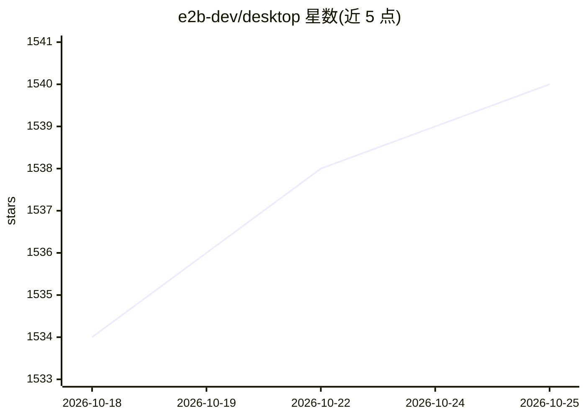

# e2b-dev/desktop

⭐ 1,540 · Python · Apache-2.0 · 推送 2026-10-25 · [GitHub](https://github.com/e2b-dev/desktop) · [官网](https://e2b.dev/?utm_source=github&utm_medium=referral&utm_campaign=repo_website&utm_content=desktop) · 组织维护

**给 LLM 用的安全虚拟桌面沙箱，支持 Computer Use**

基于 E2B Sandbox 的开源安全虚拟桌面环境，面向 Computer Use 场景：每个沙箱相互隔离、可自定义依赖。提供 Python 与 JavaScript SDK，支持屏幕流式传输（含密码保护与单应用流）、鼠标/键盘/窗口控制、截图、打开文件、启动应用、执行 bash 命令等功能。需要 E2B API key 才能运行。桌面环境基于 Linux 与 Xfce，沙箱模板可自定义构建。SDK 源码已迁移至 E2B monorepo，本仓库保留沙箱模板与示例。

## 筛选速览

| 维度 | 判定 | 备注 |
|---|---|---|
| AI 角色 | `ai-ecosystem` | LLM/agent 周边工具 |
| 许可风险 | `permissive` | Apache-2.0 |
| 部署形态 | `library` | 以包/库形式分发 |
| 模型依赖 | — | README 未给出锁定关系 |
| 硬件要求 | — | 无带数字的原话,不猜 |
| 安装摩擦 | `low` | 无编译、无系统依赖或容器化 |
| 成熟度 | — | 结构信号不足 |

## 能力要点

- 屏幕流式传输，支持密码保护与针对单个应用的流
- 鼠标/键盘/窗口控制与截图 API
- 可启动应用、打开文件并执行任意 bash 命令
- 沙箱相互隔离，模板可自定义桌面环境与依赖

## 适用场景

- 为 LLM agent 提供隔离的图形桌面执行环境
- 构建 Computer Use 类应用并流式查看桌面操作
- 自定义沙箱模板以适配特定依赖或桌面环境

## 场景标签

`GUI 自动化` · 领域:效率与自动化

## 证据(README 行号)

> L3: E2B Desktop Sandbox is an open source secure virtual desktop ready for Computer Use. Powered by E2B.
> L33: The E2B Desktop Sandbox is built on top of E2B Sandbox.

## 星数曲线

2026-10-18 1,534 → 2026-10-25 1,540（+6）

---
*卡片 v1 · prompt 1.4 · 生成 2026-10-21 · 置信度 high · 依据 README sha `dea9c25e13ff` · [字段定义](../../DATASET.md)*
