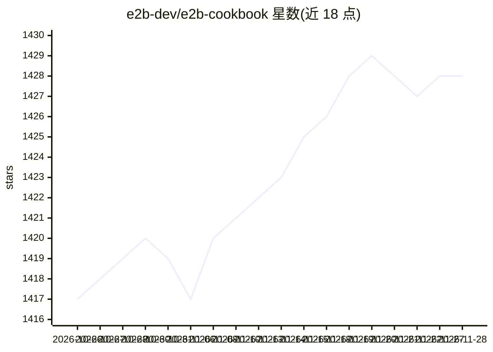

# e2b-dev/e2b-cookbook

⭐ 1,428 · TypeScript · 推送 2026-11-27 · [GitHub](https://github.com/e2b-dev/e2b-cookbook) · [官网](https://docs.e2b.dev/?utm_source=github&utm_medium=referral&utm_campaign=repo_website&utm_content=e2b-cookbook) · 组织维护

**面向使用 E2B SDK 构建的开发者的示例与指南集**

收录使用 E2B SDK 的示例代码与指南：覆盖 LLM 提供商接入（OpenAI、Anthropic、Google、Mistral、Groq、Fireworks、Together、WatsonX 等）、AI 框架集成（LangChain、LangGraph、CrewAI、Pydantic AI、Vercel AI SDK 等）、强化学习、MCP、远程执行集成与具体用例。每个示例按 Python/TypeScript 提供，并配有夜间测试套件：示例被上传到全新沙箱安装运行，以退出码判定通过，需配置 E2B_API_KEY 及所用提供商密钥。

## 筛选速览

| 维度 | 判定 | 备注 |
|---|---|---|
| AI 角色 | `ai-knowledge` | 知识聚合/清单类 |
| 许可风险 | `none` | — |
| 部署形态 | `library` | 以包/库形式分发 |
| 模型依赖 | — | README 未给出锁定关系 |
| 硬件要求 | — | 无带数字的原话,不猜 |
| 安装摩擦 | `low` | 无编译、无系统依赖或容器化 |
| 成熟度 | — | 结构信号不足 |

## 能力要点

- 按 LLM 提供商、框架集成、MCP、强化学习等分类组织的示例目录
- 每个示例提供 Python 与/或 TypeScript 两种语言版本
- 夜间测试套件自动在真实 E2B 沙箱中运行全部示例并报告结果
- hello-world 示例仅需 E2B_API_KEY 即可运行

## 适用场景

- 查找将 E2B 沙箱接入特定 LLM 提供商的示例代码
- 参考 LangChain/CrewAI 等框架与代码解释器的集成方式
- 了解在沙箱中运行 Claude Code、Codex 等 CLI 工具的做法
- 在沙箱中执行数据分析、代码解释、Web 自动化等任务时参考用例

## 场景标签

`教程课程` · 领域:学习与行业

## 证据(README 行号)

> L6: Example code and guides for building with E2B SDK.
> L10: ## Examples
> L345: Every example is exercised nightly against live E2B by `tests/run-examples.ts`: each

## 星数曲线

2026-10-26 1,417 → 2026-11-28 1,428（+11）

---
*卡片 v1 · prompt 1.4 · 生成 2026-11-23 · 置信度 high · 依据 README sha `26f82fe4e995` · [字段定义](../../DATASET.md)*
