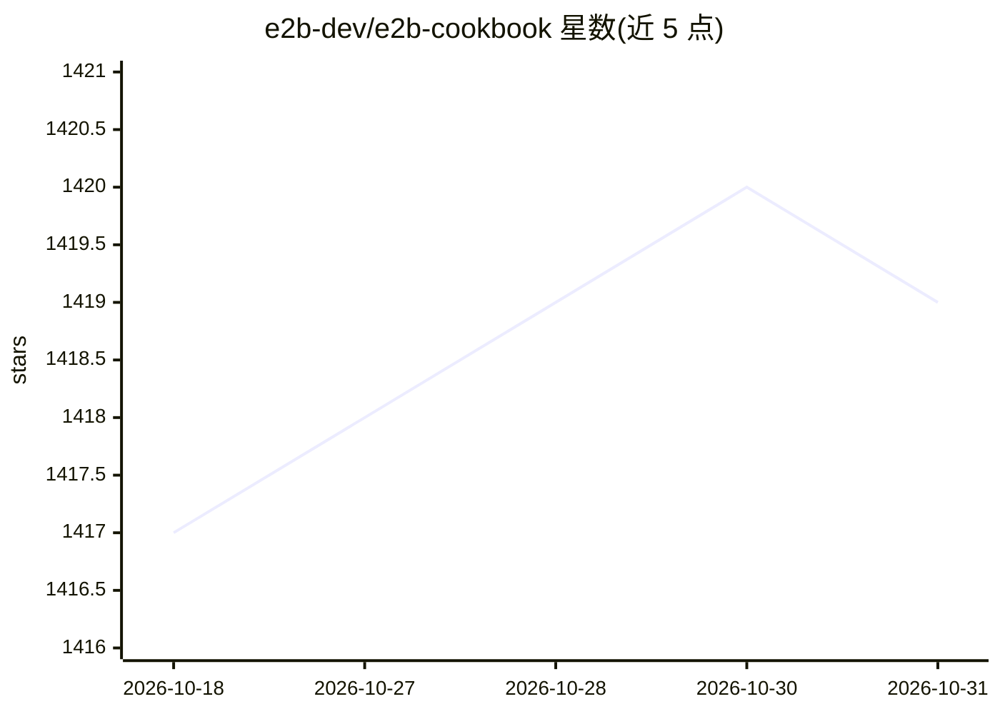

# e2b-dev/e2b-cookbook

⭐ 1,419 · TypeScript · 推送 2026-10-23 · [GitHub](https://github.com/e2b-dev/e2b-cookbook) · [官网](https://docs.e2b.dev/?utm_source=github&utm_medium=referral&utm_campaign=repo_website&utm_content=e2b-cookbook) · 组织维护

**E2B 沙箱 SDK 的示例代码与指南集合，面向 AI agent 开发者**

E2B 官方维护的 Cookbook 仓库：汇集用 E2B SDK 构建代码解释器、AI agent、computer use 应用的示例代码与指南，覆盖 Python 与 TypeScript。按 LLM 提供商（OpenAI、Anthropic、Meta、Mistral、Groq、Together 等）、AI 框架（LangChain、LangGraph、CrewAI、Vercel AI SDK 等）、MCP、强化学习与远程执行集成组织条目。每个示例每晚由 tests/run-examples.ts 在真实 E2B 沙箱中运行验证，需 E2B_API_KEY 及相应提供商 key。

## 筛选速览

| 维度 | 判定 | 备注 |
|---|---|---|
| AI 角色 | `ai-knowledge` | 知识聚合/清单类 |
| 许可风险 | `none` | — |
| 部署形态 | `library` | 以包/库形式分发 |
| 模型依赖 | — | README 未给出锁定关系 |
| 硬件要求 | — | 无带数字的原话,不猜 |
| 安装摩擦 | `low` | 无编译、无系统依赖或容器化 |
| 成熟度 | — | 结构信号不足 |

## 能力要点

- 按 LLM 提供商、AI 框架、MCP 等维度组织的示例目录（Python/TypeScript）
- 所有示例每晚上传到新沙箱安装运行并按退出码判定通过
- 测试判定以沙箱为准而非模型输出，模型非确定性行为记为 skipped

## 适用场景

- 为 AI agent 寻找沙箱内代码执行的参考实现
- 查找特定 LLM 提供商或框架与 E2B 的集成示例
- 学习 MCP 客户端/自定义模板的搭建方式

## 场景标签

`教程课程` · 领域:学习与行业

## 证据(README 行号)

> L6: Example code and guides for building with E2B SDK.
> L10: ## Examples

## 星数曲线

2026-10-18 1,417 → 2026-10-31 1,419（+2）

---
*卡片 v1 · prompt 1.4 · 生成 2026-10-21 · 置信度 high · 依据 README sha `db1e0a3bf1bd` · [字段定义](../../DATASET.md)*
