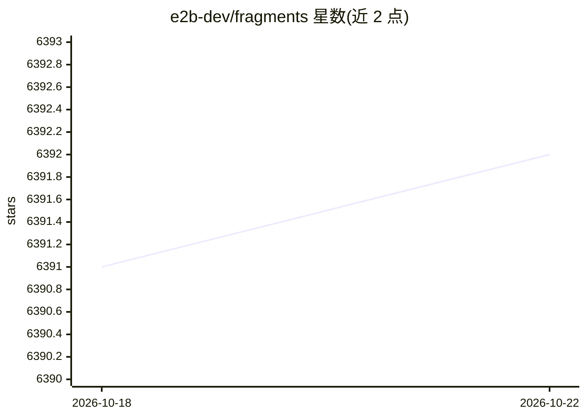

# e2b-dev/fragments

⭐ 6,397 · TypeScript · Apache-2.0 · 推送 2026-10-20 · [GitHub](https://github.com/e2b-dev/fragments) · [官网](https://fragments.e2b.dev) · 组织维护

**AI 生成全栈应用的 Next.js 模板（Claude Artifacts/v0 开源版）**

基于 Next.js 14（App Router、Server Actions）、shadcn/ui、TailwindCSS 与 Vercel AI SDK 的开源模板，用于构建由 AI 完全生成的应用，即 Claude Artifacts、Vercel v0、GPT Engineer 的开源版本。通过 E2B SDK 在安全沙箱中执行 AI 生成的代码，支持 Python、Next.js、Vue.js、Streamlit、Gradio 等技术栈，内置 OpenAI、Anthropic、Ollama 等 8 种 LLM 提供商配置，可自定义模板与提供商。运行需 git、Node.js、E2B API Key 与 LLM API Key。

## 筛选速览

| 维度 | 判定 | 备注 |
|---|---|---|
| AI 角色 | `ai-native` | 本体是模型或模型工具 |
| 许可风险 | `permissive` | Apache-2.0 |
| 部署形态 | `self-host` | docker 或自建部署 |
| 模型依赖 | local-ok | 支持本地模型 |
| 硬件要求 | — | 无带数字的原话,不猜 |
| 安装摩擦 | `low` | 无编译、无系统依赖或容器化 |
| 成熟度 | — | 结构信号不足 |

## 能力要点

- 通过 E2B SDK 在沙箱中安全执行 AI 生成代码
- 支持 Python/Next.js/Vue/Streamlit/Gradio 五种技术栈，可自行添加
- 内置 OpenAI/Anthropic/Google/Mistral/Groq/Fireworks/Together/Ollama 八种提供商
- 通过配置 models.json/templates.json 自定义模型与沙箱模板

## 适用场景

- 快速搭建自己的 AI 代码生成/Artifacts 类产品
- 在受控沙箱中运行 AI 生成的前端或 Python 代码
- 基于模板二次开发，接入自选的 LLM 提供商

## 场景标签

`代码生成` · 领域:编码与开发

## 证据(README 行号)

> L6: This is an open-source version of apps like Anthropic's Claude Artifacts, Vercel v0, or GPT Engineer.
> L15: - Uses the E2B SDK by E2B to securely execute code generated by AI.

## 星数曲线

2026-10-18 6,391 → 2026-10-22 6,392（+1）

---
*卡片 v1 · prompt 1.4 · 生成 2026-10-20 · 置信度 mid · 依据 README sha `1205f5cadafb` · [字段定义](../../DATASET.md)*
