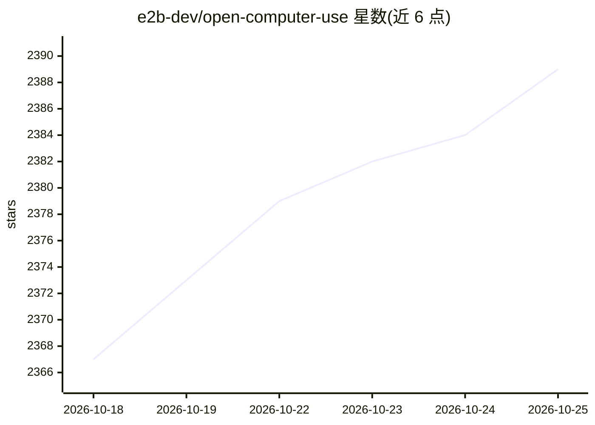

# e2b-dev/open-computer-use

⭐ 2,389 · Python · Apache-2.0 · 推送 2026-10-23 · [GitHub](https://github.com/e2b-dev/open-computer-use) · [官网](https://e2b.dev/?utm_source=github&utm_medium=referral&utm_campaign=repo_website&utm_content=open-computer-use) · 组织维护

**开源 LLM 驱动的云 Linux 计算机操作 agent**

基于 E2B Desktop Sandbox 构建的 agent 应用：在云端安全 Ubuntu 沙箱中运行，通过键盘、鼠标与 shell 命令操作计算机，客户端实时直播沙箱画面，用户可随时暂停并给出提示。模型组合在 config.py 中指定，分为 grounding/vision/action 三类，支持 Groq、Fireworks、OpenRouter、DeepSeek、Gemini、GPT-4o、Claude、OS-Atlas/ShowUI 等 10+ 模型并鼓励 PR 接入新 provider。安装需 Python 3.10+、git、E2B API key 与 LLM provider API key，通过 git clone 源码并用 Poetry 启动 Web 界面。

## 筛选速览

| 维度 | 判定 | 备注 |
|---|---|---|
| AI 角色 | `ai-native` | 本体是模型或模型工具 |
| 许可风险 | `permissive` | Apache-2.0 |
| 部署形态 | `None` |  |
| 模型依赖 | locked-api |  |
| 硬件要求 | — | 无带数字的原话,不猜 |
| 安装摩擦 | `medium` | 含编译或系统依赖之一 |
| 成熟度 | — | 结构信号不足 |

## 能力要点

- E2B Desktop Sandbox 云端安全沙箱运行 Ubuntu
- 通过键盘、鼠标与 shell 命令操作计算机并实时直播画面
- grounding/vision/action 三段模型架构，config.py 可换 10+ 种 LLM
- 运行中可暂停 agent 并随时追加提示

## 适用场景

- 让开源 LLM 在隔离沙箱中代我操作浏览器和桌面完成任务
- 以自然语言驱动 agent 执行 shell 命令并观察实时画面
- 组合不同 vision/action 模型搭建自己的 computer use agent

## 场景标签

`GUI 自动化` · 领域:效率与自动化

## 证据(README 行号)

> L3: A secure cloud Linux computer powered by E2B Desktop Sandbox and controlled by open-source LLMs.
> L10: - Operates the computer via the keyboard, mouse, and shell commands
> L25: Open Computer Use is designed to make it easy to swap in and out new LLMs. The LLMs used by the agent are specified

## 星数曲线

2026-10-18 2,367 → 2026-10-25 2,389（+22）

---
*卡片 v1 · prompt 1.4 · 生成 2026-10-21 · 置信度 high · 依据 README sha `8aaf90a65266` · [字段定义](../../DATASET.md)*
