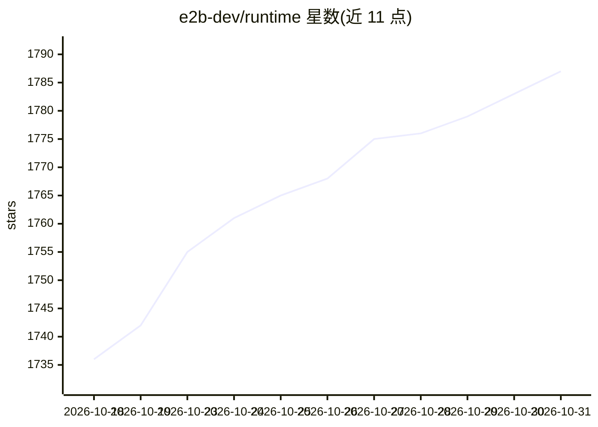

# e2b-dev/runtime

⭐ 1,787 · Go · Apache-2.0 · 推送 2026-10-30 · [GitHub](https://github.com/e2b-dev/runtime) · [官网](https://e2b.dev/?utm_source=github&utm_medium=referral&utm_campaign=repo_website&utm_content=runtime) · 组织维护

**AI agent 沙箱运行时：Firecracker microVM 运行不受信代码**

E2B 的开源后端运行时，用 Go 编写，为每个 agent 会话提供一个硬件隔离的 Firecracker microVM Linux 沙箱，可从快照恢复、暂停/恢复、fork 运行中的沙箱。包含控制面 API、节点编排器、VM 内 envd 进程/文件系统 API、边缘路由与模板构建器。同一代码服务公有云、企业私有部署与单机 Embed 包（docker compose 自托管，需 Linux + KVM），SDK 提供 JavaScript 与 Python。

## 筛选速览

| 维度 | 判定 | 备注 |
|---|---|---|
| AI 角色 | `ai-ecosystem` | LLM/agent 周边工具 |
| 许可风险 | `permissive` | Apache-2.0 |
| 部署形态 | `self-host` | docker 或自建部署 |
| 模型依赖 | — | README 未给出锁定关系 |
| 硬件要求 | — | 无带数字的原话,不猜 |
| 安装摩擦 | `low` | 无编译、无系统依赖或容器化 |
| 成熟度 | — | 结构信号不足 |

## 能力要点

- 每个沙箱一个 Firecracker microVM，独立 cgroup/网络命名空间/nftables 出口防火墙
- 快照恢复式创建：userfaultfd 懒加载内存页 + CoW 根文件系统
- 暂停/恢复与在运行沙箱上 fork（单次最多 100 个）
- 单机 Embed 包经 docker compose 自托管，另有 Terraform（GCP/AWS/Azure）与 Kubernetes 清单

## 适用场景

- 为 AI agent 提供隔离的代码执行沙箱并追踪到底层内核
- 平台团队在自己云账号内运行 agent 执行基础设施
- 研究 Firecracker 与快照调度在规模化下的实现

## 场景标签

 · 领域:AI agent 基础设施/云原生

## 证据(README 行号)

> L5: **The open-source runtime behind E2B, the AI agent cloud. Firecracker microVMs that resume from a snapshot, run untr
> L22: E2B Runtime is the complete backend that powers E2B Cloud: the control-plane API, the per-node orchestrator that dr

## 星数曲线

2026-10-18 1,736 → 2026-10-31 1,787（+51）

---
*卡片 v1 · prompt 1.4 · 生成 2026-10-21 · 置信度 high · 依据 README sha `8f025525f924` · [字段定义](../../DATASET.md)*
