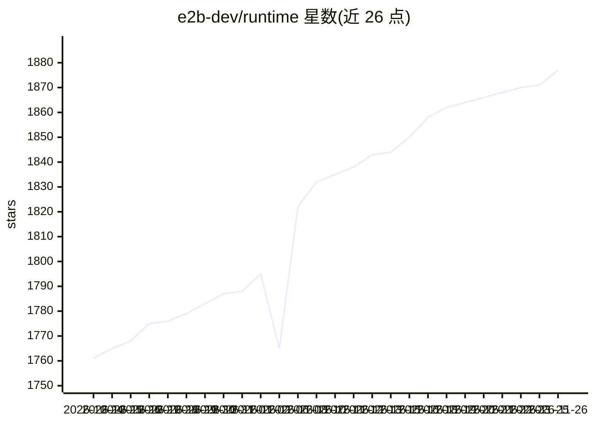

# e2b-dev/runtime

⭐ 1,877 · Go · Apache-2.0 · 推送 2026-11-25 · [GitHub](https://github.com/e2b-dev/runtime) · [官网](https://e2b.dev/?utm_source=github&utm_medium=referral&utm_campaign=repo_website&utm_content=runtime) · 组织维护

**为 AI agent 提供快照恢复型 Firecracker 沙箱的开源运行时**

E2B Cloud 背后的完整后端运行时：控制面 API、驱动 Firecracker 的节点编排器、VM 内的 envd 服务、边缘路由与模板构建器，为每个 agent 会话提供隔离的 Linux 沙箱。沙箱从预启动快照恢复而非冷启动内核，经 userfaultfd 惰性加载内存页、CoW overlay 根文件系统，支持暂停/恢复与运行中沙箱的检查点分叉。Go 编写，Apache-2.0 许可，同一份代码服务公有云、企业专有部署与单机 Embed 包。

## 筛选速览

| 维度 | 判定 | 备注 |
|---|---|---|
| AI 角色 | `ai-ecosystem` | LLM/agent 周边工具 |
| 许可风险 | `permissive` | Apache-2.0 |
| 部署形态 | `self-host` | docker 或自建部署 |
| 模型依赖 | — | README 未给出锁定关系 |
| 硬件要求 | — | 无带数字的原话,不猜 |
| 安装摩擦 | `low` | 无编译、无系统依赖或容器化 |
| 成熟度 | — | 结构信号不足 |

## 能力要点

- Firecracker microVM 硬件隔离沙箱，每沙箱独立 cgroup 与网络命名空间及 nftables 出口防火墙
- 快照恢复式创建：userfaultfd 惰性内存加载 + CoW 根文件系统
- 暂停/恢复与运行中沙箱分叉（单次最多百个）
- envd 在 VM 内暴露进程、PTY、文件系统与端口转发 API，可热升级

## 适用场景

- 为 agent 会话运行不受信代码并提供内核级隔离
- 在自有云账户/单机上部署 agent 执行基础设施
- 本地运行与生产一致的沙箱运行时进行开发调试

## 场景标签

 · 领域:AI agent 基础设施/云运行时

## 证据(README 行号)

> L5: **The open-source runtime behind E2B, the AI agent cloud. Firecracker microVMs that resume from a snapshot, run untr
> L22: E2B Runtime is the complete backend that powers E2B Cloud: the control-plane API, the per-node orchestrator that dr

## 星数曲线

2026-10-24 1,761 → 2026-11-26 1,877（+116）

---
*卡片 v1 · prompt 1.4 · 生成 2026-11-23 · 置信度 high · 依据 README sha `cc70dbff0774` · [字段定义](../../DATASET.md)*
