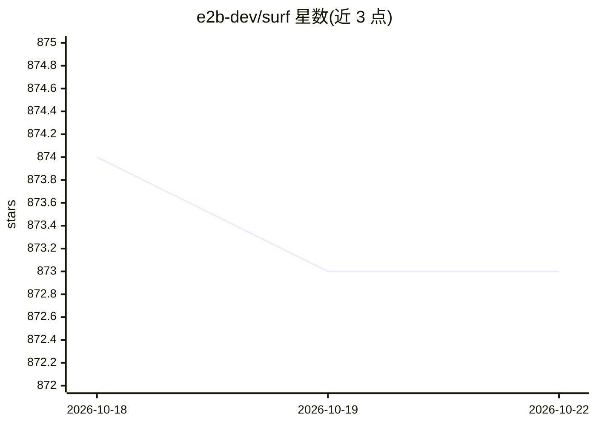

# e2b-dev/surf

⭐ 873 · TypeScript · Apache-2.0 · 推送 2026-10-13 · [GitHub](https://github.com/e2b-dev/surf) · [官网](https://surf.e2b.dev) · 组织维护

**让 AI agent 在虚拟桌面中执行自然语言指令的 Next.js 应用**

基于 Next.js 的 Web 应用：接入 E2B 桌面沙箱与 OpenAI Computer Use API，用户通过聊天界面发送自然语言指令，AI 生成点击、输入等操作并在云端 Linux 虚拟桌面上执行，过程经 SSE 实时流式展示。运行需 Node.js/npm、E2B API key 与 OpenAI API key，通过 git clone、npm install、npm run dev 启动；沙箱实例有计时与自动延长机制。面向希望观察和体验 computer use agent 的开发者。

## 筛选速览

| 维度 | 判定 | 备注 |
|---|---|---|
| AI 角色 | `ai-native` | 本体是模型或模型工具 |
| 许可风险 | `permissive` | Apache-2.0 |
| 部署形态 | `library` | 以包/库形式分发 |
| 模型依赖 | — | README 未给出锁定关系 |
| 硬件要求 | — | 无带数字的原话,不猜 |
| 安装摩擦 | `low` | 无编译、无系统依赖或容器化 |
| 成熟度 | — | 结构信号不足 |

## 能力要点

- 自然语言驱动 AI 在虚拟桌面执行点击/输入等操作
- SSE 实时流式展示 AI 推理与动作
- 沙箱实例管理：计时、自动延长、手动停止
- 支持明暗主题与示例指令

## 适用场景

- 体验 OpenAI computer use agent 操作虚拟桌面
- 观察 AI agent 在沙箱中执行任务的推理与动作过程
- 作为 computer use 应用的参考实现进行二次开发

## 场景标签

`GUI 自动化` · 领域:效率与自动化

## 证据(README 行号)

> L4: # 🏄 Surf - OpenAI's Computer Use Agent + E2B Desktop
> L6: A Next.js application that allows AI to interact with a virtual desktop environment. This project integrates E2B's d
> L29: 3. **OpenAI Computer Use**: Processes user instructions and generates actions for the AI agent

## 星数曲线

2026-10-18 874 → 2026-10-22 873（-1）

---
*卡片 v1 · prompt 1.4 · 生成 2026-10-21 · 置信度 high · 依据 README sha `66c26b5e4cb5` · [字段定义](../../DATASET.md)*
