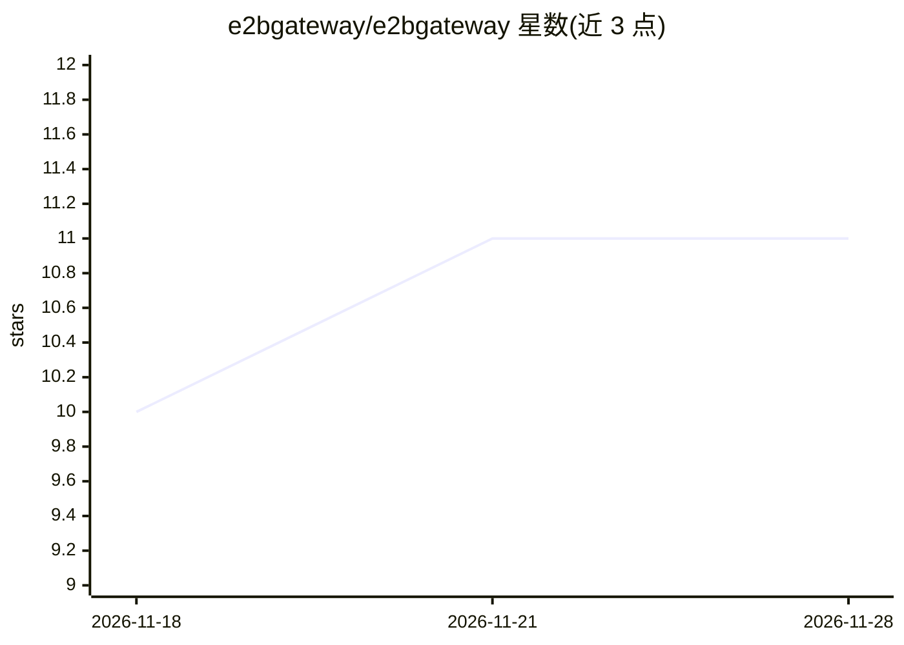

# e2bgateway/e2bgateway

⭐ 11 · Go · Apache-2.0 · 推送 2026-11-27 · [GitHub](https://github.com/e2bgateway/e2bgateway) · [官网](https://deepwiki.com/e2bgateway/e2bgateway) · 组织维护

**给 AI agent 沙箱用的统一网关：兼容 E2B API 接多后端**

一个 AI agent 沙箱抽象网关层，实现与官方 E2B 客户端协议完全兼容的接口，将请求透明路由到不同底层运行时（E2B Cloud、agent-sandbox、OpenSandbox，另有 CubeSandbox 等规划中后端）。提供沙箱生命周期、代码执行、Shell 命令、文件系统、端口转发与模板管理的 REST API 及 WebSocket 流式通道，内置认证、限流、审计日志与 OpenTelemetry 可观测性。Go 语言实现，提供 make build 构建方式与 YAML 配置文件，支持 HTTPS 监听。

## 筛选速览

| 维度 | 判定 | 备注 |
|---|---|---|
| AI 角色 | `ai-ecosystem` | LLM/agent 周边工具 |
| 许可风险 | `permissive` | Apache-2.0 |
| 部署形态 | `None` |  |
| 模型依赖 | — | README 未给出锁定关系 |
| 硬件要求 | — | 无带数字的原话,不猜 |
| 安装摩擦 | `low` | 无编译、无系统依赖或容器化 |
| 成熟度 | — | 结构信号不足 |

## 能力要点

- 实现完整 E2B REST API，现有 E2B SDK 用户仅改 URL 即可接入
- 多后端动态路由、负载均衡与故障转移
- 内置认证、限流、审计日志与 OpenTelemetry
- 支持 Kubernetes CRD（SandboxClaim）与容器型沙箱后端

## 适用场景

- 在不更换沙箱后端的前提下迁移或混用多个沙箱运行时
- 在 Kubernetes 集群中为 agent 提供统一的沙箱 API 入口
- 为多沙箱集群做路由、负载均衡与故障转移

## 场景标签

 · 领域:AI agent 基础设施/沙箱网关

## 证据(README 行号)

> L27: E2BGateway acts as an abstraction gateway layer for AI agent sandboxes. It provides a fully compatible interface al
> L33: - **Multi-backend routing** — Dynamic routing, load balancing, and failover between sandbox clusters

## 星数曲线

2026-11-18 10 → 2026-11-28 11（+1）

---
*卡片 v1 · prompt 1.4 · 生成 2026-11-19 · 置信度 high · 依据 README sha `65761a0acd46` · [字段定义](../../DATASET.md)*
