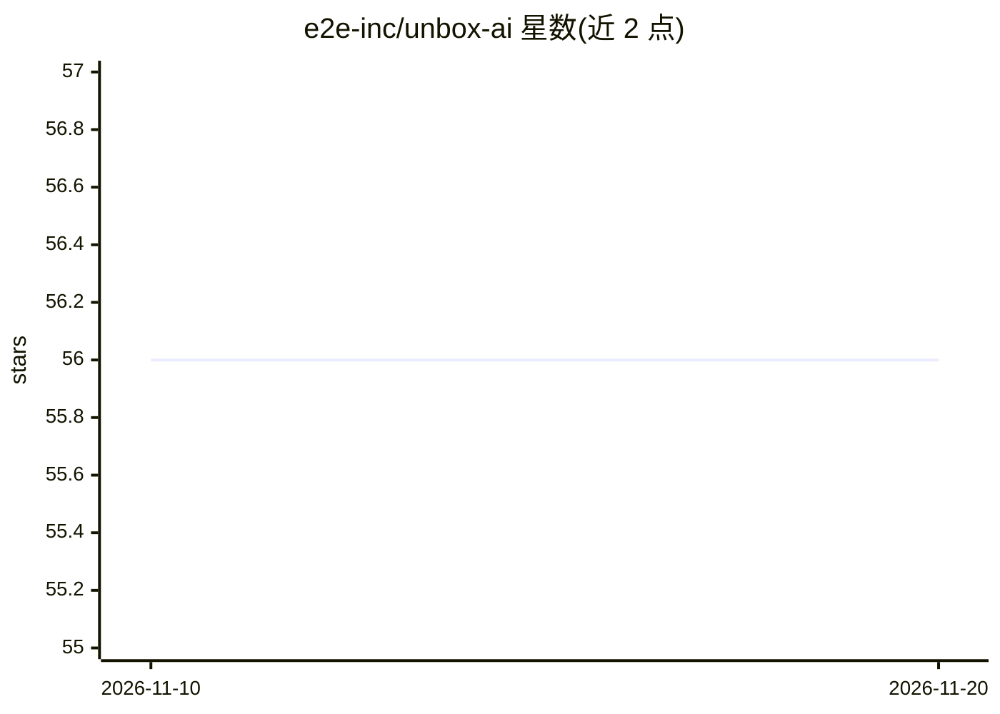

# e2e-inc/unbox-ai

⭐ 56 · TypeScript · MIT · 推送 2026-11-12 · [GitHub](https://github.com/e2e-inc/unbox-ai) · [官网](https://tester.army) · 组织维护

**AI agent 追踪可视化工具：token、延迟与成本浏览器化呈现**

将 AI agent trace 文件转为本地浏览器可视化：按 system prompt、工具定义、消息做输入 token 树状图，含 TTFT/成本/延迟瀑布图与去重对话视图。同一二进制提供有界、只读的 CLI（runs/summary/compare/event），面向编码 agent 可安全白名单化，支持 A/B 对比 token/成本/耗时差异。读取网关导出、opencode 会话导出与 AI SDK devtools 数据库三类格式；token 归因按字符比例估算并标注。以 npx 直接运行，另附带 agent skill 安装。

## 筛选速览

| 维度 | 判定 | 备注 |
|---|---|---|
| AI 角色 | `ai-ecosystem` | LLM/agent 周边工具 |
| 许可风险 | `permissive` | MIT |
| 部署形态 | `library` | 以包/库形式分发 |
| 模型依赖 | — | README 未给出锁定关系 |
| 硬件要求 | — | 无带数字的原话,不猜 |
| 安装摩擦 | `low` | 无编译、无系统依赖或容器化 |
| 成熟度 | — | 结构信号不足 |

## 能力要点

- 输入 token 树状图：system prompt / 工具定义 / 消息分别归因
- 延迟瀑布图含 TTFT、tokens 与每次生成成本
- compare 命令做 prompt/模型 A/B：token/成本/耗时/工具使用差异与轨迹对齐（LCS）
- Agent 安全 CLI：输出封顶、--json、非 TTY 下不启动服务器

## 适用场景

- 把 agent 追踪文件拖进来，看 token 和成本花在哪里
- 对比两次运行的提示词/模型差异与轨迹分歧
- 让编码 agent 用只读命令自助排查自己的追踪文件

## 场景标签

`LLM 可观测性` · 领域:评测与运维

## 证据(README 行号)

> L16: unbox-ai turns an AI agent trace into something you can read. One command opens
> L89: - **Context treemap** - input tokens attributed to system prompt, each tool

## 星数曲线

2026-11-10 56 → 2026-11-20 56（+0）

---
*卡片 v1 · prompt 1.4 · 生成 2026-11-18 · 置信度 high · 依据 README sha `3184aa9aef7f` · [字段定义](../../DATASET.md)*
