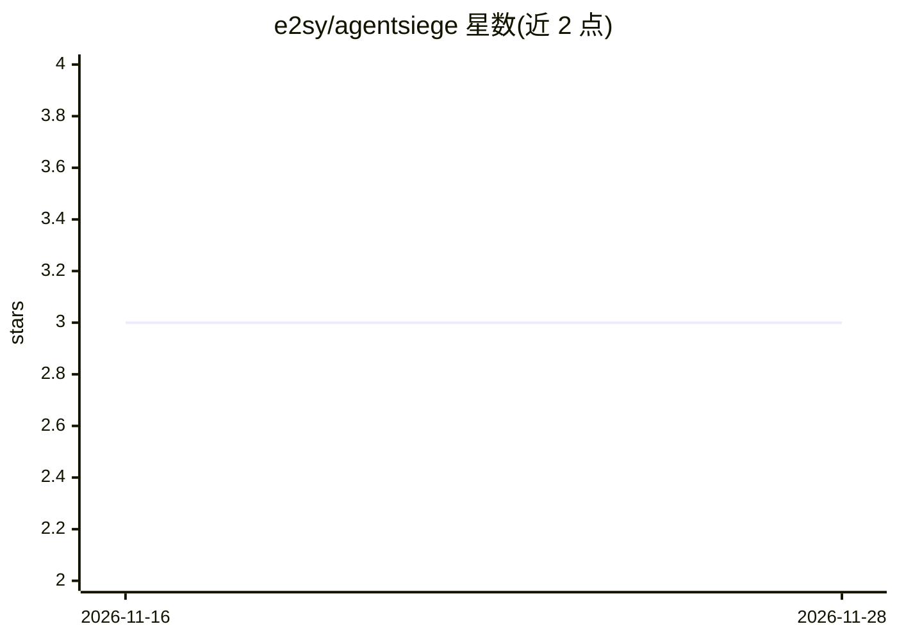

# e2sy/agentsiege

⭐ 3 · TypeScript · Apache-2.0 · 推送 2026-10-18 · [GitHub](https://github.com/e2sy/agentsiege) · 个人维护

**对 AI 应用、agent 与 MCP 服务器做自动化红队渗透测试的工具**

自托管的多 agent 攻击集群：由 orchestrator、recon、strategist、attacker、judge、reporter 协作对用户自有端点执行多轮越狱、提示注入、凭据诱饵、伪造工具输出等攻击，产出 OWASP 映射的发现、可复现 PoC 与自动生成的回归测试。附带 Next.js 版 Mission Control 仪表盘（零 API key 的内置演示目标）、MCP 配置扫描器（7 个检测器）、69 个种子 playbook 与 SARIF 2.1/NDJSON 输出。需 Node ≥18.17，仅限测试自有或获授权的系统。

## 筛选速览

| 维度 | 判定 | 备注 |
|---|---|---|
| AI 角色 | `ai-ecosystem` | LLM/agent 周边工具 |
| 许可风险 | `permissive` | Apache-2.0 |
| 部署形态 | `library` | 以包/库形式分发 |
| 模型依赖 | local-ok | 支持本地模型 |
| 硬件要求 | — | 无带数字的原话,不猜 |
| 安装摩擦 | `low` | 无编译、无系统依赖或容器化 |
| 成熟度 | — | 结构信号不足 |

## 能力要点

- 多 agent 协同攻击集群（recon/strategist/attacker/judge/reporter）与全局调用预算 kill switch
- 69 个种子 playbook，映射 OWASP LLM Top-10，支持 LLM 自适应追问与确定性回放
- MCP 配置扫描器：检测工具投毒、rug-pull、影子工具、过度权限、硬编码密钥等 7 类问题
- CI 集成：非零退出码、自动生成 node:test 回归测试、SARIF 2.1 上传 Security tab

## 适用场景

- 上线前对自有 AI agent 做自动化红队测试
- 扫描本机 MCP 配置中的投毒与权限风险
- 在 CI 流水线中门禁化拦截越狱回归
- 将确认的攻击发现转化为加固的系统提示词与工具策略

## 场景标签

`网络安全` `多智能体` · 领域:Agent 开发

## 证据(README 行号)

> L70: AgentSiege is a self-hosted swarm of coordinated attack agents that probes
> L101: - **MCP-native** — passively scans MCP configs and tool descriptions for
> L120: Requires Node ≥ 18.17.

## 星数曲线

2026-11-16 3 → 2026-11-28 3（+0）

---
*卡片 v1 · prompt 1.4 · 生成 2026-11-22 · 置信度 high · 依据 README sha `5ee30e958e33` · [字段定义](../../DATASET.md)*
