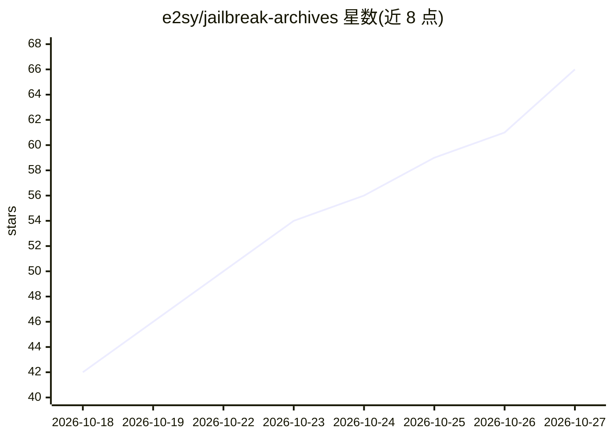

# e2sy/jailbreak-archives

⭐ 66 · Roff · MIT · 推送 2026-10-26 · [GitHub](https://github.com/e2sy/jailbreak-archives) · [官网](https://www.youtube.com/@mayankforge) · 个人维护

**面向 AI 安全研究的 LLM 越狱提示词结构化版本化存档（16 条，7 模型族）**

收录针对 ChatGPT、Claude、DeepSeek、Grok、Qwen、GLM、Antigravity-Claude 的越狱提示词与对抗性提示工程技术存档：每条条目含原文 payload、模型版本锚定、YAML 结构化元数据（模型族、技术、状态、机制、缓解措施），支持程序化解析与回归测试。条目状态分 Active/Unverified/Patched/Restricted 四类，厂商修复后保留为回归测试参照。采用厂商协调披露流程，仅发布已负责任披露或可安全发布的技术，供红队与防御加固研究使用，MIT 许可。

## 筛选速览

| 维度 | 判定 | 备注 |
|---|---|---|
| AI 角色 | `ai-knowledge` | 知识聚合/清单类 |
| 许可风险 | `permissive` | MIT |
| 部署形态 | `desktop` | 安装包/桌面程序 |
| 模型依赖 | — | README 未给出锁定关系 |
| 硬件要求 | — | 无带数字的原话,不猜 |
| 安装摩擦 | `low` | 无编译、无系统依赖或容器化 |
| 成熟度 | — | 结构信号不足 |

## 能力要点

- 每条条目 YAML front-matter 元数据（entry_id、model_family、status 等）支持程序化解析
- 版本锚定快照，条目固定到具体模型版本以复现回归
- 厂商协调披露流程与 Restricted 状态扣留机制
- CI 校验（Markdown lint、结构验证、密钥扫描）与 CITATION.cff 引用支持

## 适用场景

- 红队与 AI 安全研究需要一个稳定的越狱技术参照集
- 下游检测规则与系统提示加固方案以此存档做基准评测
- 跟踪各模型厂商修复后条目作为回归测试参照

## 场景标签

`网络安全` · 领域:学习与行业

## 证据(README 行号)

> L5: **A structured, versioned, and reproducible archive of jailbreak prompts and adversarial techniques for LLMs — ChatG
> L23: Each entry is pinned to the specific model version it was observed against, and carries structured YAML metadata (`

## 星数曲线

2026-10-18 42 → 2026-10-27 66（+24）

---
*卡片 v1 · prompt 1.4 · 生成 2026-10-24 · 置信度 high · 依据 README sha `af97cd835043` · [字段定义](../../DATASET.md)*
