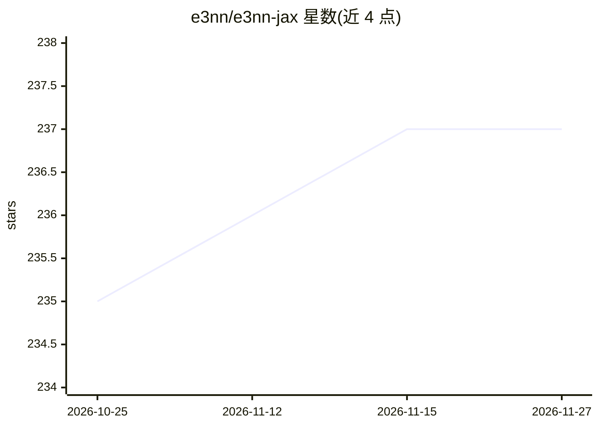

# e3nn/e3nn-jax

⭐ 237 · Python · Apache-2.0 · 推送 2026-11-17 · [GitHub](https://github.com/e3nn/e3nn-jax) · 组织维护

**基于 JAX 的 E3 等变神经网络库**

e3nn 的 JAX 实现，提供构建 E(3) 等变神经网络的组件库；核心数据结构为 IrrepsArray，将不可约表示（Irreps）与数据数组一同携带，用于处理具有旋转/平移等变性的 3D 数据。通过 pip 从 PyPI 或 GitHub 源安装，提供在线文档，接受社区提问于 discussions 区，并给出引用文献条目。

## 筛选速览

| 维度 | 判定 | 备注 |
|---|---|---|
| AI 角色 | `ai-native` | 本体是模型或模型工具 |
| 许可风险 | `permissive` | Apache-2.0 |
| 部署形态 | `library` | 以包/库形式分发 |
| 模型依赖 | — | README 未给出锁定关系 |
| 硬件要求 | — | 无带数字的原话,不猜 |
| 安装摩擦 | `low` | 无编译、无系统依赖或容器化 |
| 成熟度 | — | 结构信号不足 |

## 能力要点

- 提供 IrrepsArray 数据结构（不可约表示 + 数据数组）
- 支持旋转与平移等变神经网络计算
- 提供 PyPI 与 GitHub 源码两种安装方式
- 提供在线文档与 CHANGELOG 跟踪破坏性变更

## 适用场景

- 构建处理 3D 点云的等变神经网络
- 在 JAX 生态中开发具有旋转等变性的科学计算模型
- 迁移已有 PyTorch 版 e3nn 项目到 JAX

## 场景标签

 · 领域:机器学习框架/科学计算

## 证据(README 行号)

> L1: # e3nn-jax
> L34: The main difference is the presence of the class `IrrepsArray`.
> L42:       title={Tensor field networks: Rotation- and translation-equivariant neural networks for 3D point clouds},

## 星数曲线

2026-10-25 235 → 2026-11-27 237（+2）

---
*卡片 v1 · prompt 1.4 · 生成 2026-11-27 · 置信度 high · 依据 README sha `a5d86e4791e1` · [字段定义](../../DATASET.md)*
