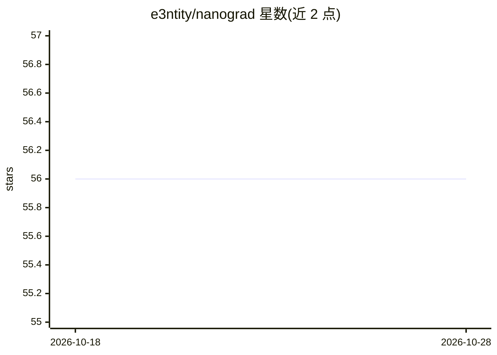

# e3ntity/nanograd

⭐ 56 · Rust · MIT · 推送 2026-05-25 · [GitHub](https://github.com/e3ntity/nanograd) · 个人维护

**Rust 从零实现的标量自动微分引擎，教学用途**

用 Rust 从零编写的极简自动微分引擎，仅依赖 image 与 rand 两个库。核心机制：每个 Scalar 存储值、可选梯度与产生该值的操作 Edge；运算符重载在构建有向无环计算图时缓存每条边的局部导数，backward() 从输出节点递归传播梯度到叶子节点。内置三个示例：XOR 的 MLP 训练、MNIST CNN 训练（并在 0.0.0.0:8200 提供浏览器手写数字识别演示），以及用 plot::dump_graph 导出自包含 D3.js HTML 计算图。面向学习自动微分与神经网络原理的开发者。

## 筛选速览

| 维度 | 判定 | 备注 |
|---|---|---|
| AI 角色 | `ai-ecosystem` | LLM/agent 周边工具 |
| 许可风险 | `permissive` | MIT |
| 部署形态 | `None` |  |
| 模型依赖 | — | README 未给出锁定关系 |
| 硬件要求 | — | 无带数字的原话,不猜 |
| 安装摩擦 | `low` | 无编译、无系统依赖或容器化 |
| 成熟度 | — | 结构信号不足 |

## 能力要点

- 标量级自动微分：Scalar/Edge 构建计算图并递归反向传播梯度
- 仅依赖 image 与 rand，其余从零实现
- 内置 XOR MLP 与 MNIST CNN 训练示例
- dump_graph 导出自包含 D3.js 交互式计算图可视化

## 适用场景

- 学习自动微分引擎的实现原理
- 在浏览器演示中观察手写数字识别的实时类别概率
- 可视化神经网络前向传播的计算图

## 场景标签

`教程课程` · 领域:学习与行业

## 证据(README 行号)

> L3: Minimal automatic-differentiation engine written in Rust.
> L5: Everything is built from scratch, the only dependencies are `image` (for decoding PNGs) and `rand`.

## 星数曲线

2026-10-18 56 → 2026-10-28 56（+0）

---
*卡片 v1 · prompt 1.4 · 生成 2026-10-24 · 置信度 high · 依据 README sha `02c40648a82e` · [字段定义](../../DATASET.md)*
