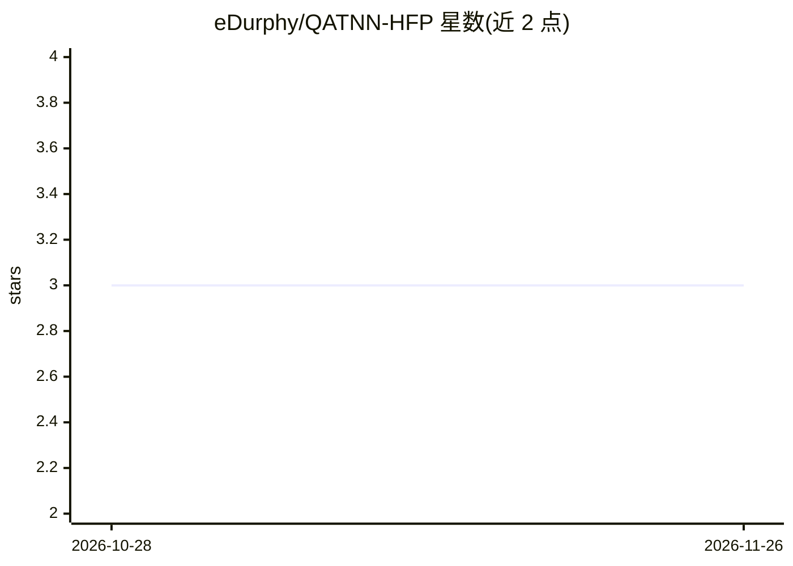

# eDurphy/QATNN-HFP

⭐ 3 · NOASSERTION · 推送 2026-10-27 · [GitHub](https://github.com/eDurphy/QATNN-HFP) · 个人维护 · 中文 README

**三值整数量化神经网络训练与推理的学术论文阅读指南**

README 本身是论文 QATNN-HFP-EN.pdf 的导读文件，介绍一项三值（-1/0/+1）纯整数前向与反向训练及推理方案：trit 作为矩阵遍历的基本单元，浮点仅保留在向量归一化，推理无乘法器，约 1.6 比特/权重。文档说明论文十个章节的结构、算子逐位精确规范、RWKV-6 语言模型集成，以及可复现性核查结果（182 个公式字节级一致等），并给出引用条目。面向希望阅读或复核该论文的研究者。

## 筛选速览

| 维度 | 判定 | 备注 |
|---|---|---|
| AI 角色 | `ai-knowledge` | 知识聚合/清单类 |
| 许可风险 | `none` | NOASSERTION |
| 部署形态 | `None` |  |
| 模型依赖 | — | README 未给出锁定关系 |
| 硬件要求 | — | 无带数字的原话,不猜 |
| 安装摩擦 | `low` | 无编译、无系统依赖或容器化 |
| 成熟度 | — | 结构信号不足 |

## 能力要点

- 三值权重纯整数训练与推理，推理无乘法器，约 1.625 bit/权重
- 逐算子位精确规范（§1–§9）与阈值可达性分析
- RWKV-6 Finch 线性递归集成，无注意力/空间 softmax
- 可复现性核查：182 个 Office-Math 公式字节级一致

## 适用场景

- 阅读该论文前了解其章节结构与技术要点
- 复核论文翻译的保真度与公式一致性
- 查找三值量化与整数控训练的相关文献线索

## 场景标签

`科研工具` `教程课程` · 领域:学习与行业

## 证据(README 行号)

> L1: # QATNN-HFP — Paper README
> L3: Reader's guide to **QATNN-HFP-EN.pdf**: *Quantized Adaptive Trainer Neural Network – Hybrid Fixed Point* — a ternary
> L5: ## What this paper is

## 星数曲线

2026-10-28 3 → 2026-11-26 3（+0）

---
*卡片 v1 · prompt 1.4 · 生成 2026-11-22 · 置信度 high · 依据 README sha `3c15ff1514db` · [字段定义](../../DATASET.md)*
