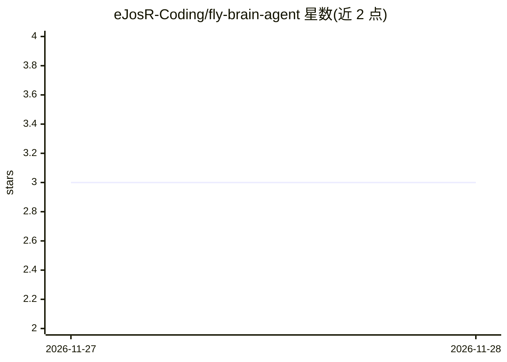

# eJosR-Coding/fly-brain-agent

⭐ 3 · Python · GPL-3.0 · 推送 2026-11-22 · [GitHub](https://github.com/eJosR-Coding/fly-brain-agent) · 个人维护

**让科研人员用自然语言查询果蝇全脑连接组与实时仿真的 LLM agent**

基于 FlyWire 成年果蝇脑连接组（v783，139,248 个神经元）构建的对话式 agent：将神经元搜索、计数、描述等操作封装为 MCP 工具，由语言模型选择工具执行，回答基于真实连接组数据而非模型记忆；另含实时仿真模块，模拟果蝇的行走、取食、逃避等行为（漏积分神经元模型，CPU/GPU 均可运行）。通过 LangChain init_chat_model 支持任意 provider 模型，搜索结果以 selection ticket 压缩返回以控制 token 用量，工具循环设有硬性步数上限。GPL v3 许可，uv 管理依赖。

## 筛选速览

| 维度 | 判定 | 备注 |
|---|---|---|
| AI 角色 | `ai-native` | 本体是模型或模型工具 |
| 许可风险 | `viral` | GPL-3.0 |
| 部署形态 | `library` | 以包/库形式分发 |
| 模型依赖 | — | README 未给出锁定关系 |
| 硬件要求 | — | 无带数字的原话,不猜 |
| 安装摩擦 | `low` | 无编译、无系统依赖或容器化 |
| 成熟度 | — | 结构信号不足 |

## 能力要点

- 139,248 神经元连接组封装为 MCP 工具，可接入 Claude Code 等任意 MCP 客户端
- selection ticket 机制：86k 匹配结果压缩为约 1.3k 字符的引用票据
- 手写 LangGraph 工具循环，带硬性步数限制防死循环
- 50 ms 粒度实时仿真，行为来源在代码中标注"connectome 模型 vs 自定规则"

## 适用场景

- 用自然语言查询多巴胺神经元数量、细胞类型等连接组问题
- 通过 MCP 客户端将果蝇脑数据接入自己的 agent 工作流
- 观察仿真果蝇对糖块、苦味刺激的行为响应并溯源到神经回路

## 场景标签

`科研工具` · 领域:学习与行业

## 证据(README 行号)

> L8: 1. an LLM agent that lets you talk to a whole fruit-fly brain, neuron by neuron.
> L34: The FlyWire project mapped every neuron of an adult fruit-fly brain. This repo turns that
> L36: count them, describe one, page through results. The agent picks the tools, we run them,

## 星数曲线

2026-11-27 3 → 2026-11-28 3（+0）

---
*卡片 v1 · prompt 1.4 · 生成 2026-11-27 · 置信度 mid · 依据 README sha `a6d293cc005b` · [字段定义](../../DATASET.md)*
