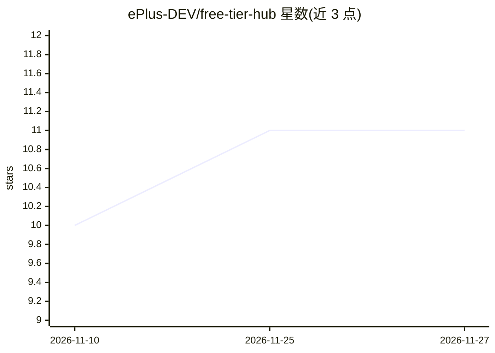

# ePlus-DEV/free-tier-hub

⭐ 11 · JavaScript · MIT · 推送 2026-11-26 · [GitHub](https://github.com/ePlus-DEV/free-tier-hub) · [官网](http://free-tier.eplus.dev/) · 组织维护

**免费额度云服务与开发工具的社区维护目录站点**

一个社区维护的免费开发者资源目录，收录主机托管、数据库、存储、API、AI/ML 平台等类别的免费额度服务，按 22 个类别组织，提供免费限额、支付卡要求、商用条款、部署方式等条目信息，并区分长期免费额度与限时优惠，标注最近核查时间。站点基于 Node.js 24 与 GitHub Pages 构建，条目数据以 JSON 存储，欢迎社区贡献与纠错，工具链采用 MIT 许可。

## 筛选速览

| 维度 | 判定 | 备注 |
|---|---|---|
| AI 角色 | `ai-knowledge` | 知识聚合/清单类 |
| 许可风险 | `permissive` | MIT |
| 部署形态 | `None` |  |
| 模型依赖 | — | README 未给出锁定关系 |
| 硬件要求 | — | 无带数字的原话,不猜 |
| 安装摩擦 | `low` | 无编译、无系统依赖或容器化 |
| 成熟度 | — | 结构信号不足 |

## 能力要点

- 覆盖主机、数据库、存储、AI/ML 等 22 个类别的免费额度目录
- 区分免费额度、限时优惠、New (48h) 等多种统计口径
- 条目标注限额、支付卡要求、商用条款与最后核查时间
- 本地校验与构建命令：catalog:sync / verify / build

## 适用场景

- 上线个人项目前寻找免费托管与数据库方案
- 对比各平台免费额度限制与超额费用
- 学生查找教育专项免费资源

## 场景标签

`精选清单` · 领域:学习与行业

## 证据(README 行号)

> L3: **Build More, Spend Less.** Discover and compare free developer tools and services in one independent, community-mai
> L36: |AI & ML platforms|Count|Browse|

## 星数曲线

2026-11-10 10 → 2026-11-27 11（+1）

---
*卡片 v1 · prompt 1.4 · 生成 2026-11-19 · 置信度 high · 依据 README sha `04586383d07c` · [字段定义](../../DATASET.md)*
