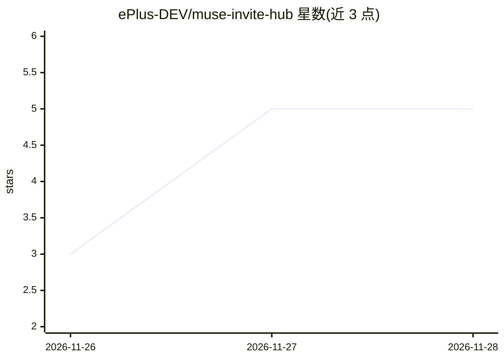

# ePlus-DEV/muse-invite-hub

⭐ 5 · JavaScript · MIT · 推送 2026-11-27 · [GitHub](https://github.com/ePlus-DEV/muse-invite-hub) · [官网](https://muse.eplus.dev/) · 组织维护

**社区共享的 Muse AI 邀请码目录站**

由 ePlus.DEV 维护的开源静态站点，汇总社区在 GitHub、Threads、X、Facebook、Telegram 分享的 Muse 邀请码，提供浏览、搜索、过滤、收藏与复制状态记录。邀请码需符合 6 位字母数字格式；贡献通过 Issue 表单与 Telegram 机器人提交，经重复检查与 CI 验证后可自动发布为 unverified 状态，反馈以 JSON 台账记录并仅在被审核合并后计数。站点为纯静态 HTML/CSS/JS，无后端与 npm 依赖；Telegram 机器人是可选的独立 Node.js 24 服务。声明为独立社区项目，与 Meta 无关联，不保证邀请码可用。

## 筛选速览

| 维度 | 判定 | 备注 |
|---|---|---|
| AI 角色 | `ai-knowledge` | 知识聚合/清单类 |
| 许可风险 | `permissive` | MIT |
| 部署形态 | `self-host` | docker 或自建部署 |
| 模型依赖 | — | README 未给出锁定关系 |
| 硬件要求 | — | 无带数字的原话,不猜 |
| 安装摩擦 | `low` | 无编译、无系统依赖或容器化 |
| 成熟度 | — | 结构信号不足 |

## 能力要点

- 汇总多平台来源的 Muse 邀请码，含七国可用性地图
- Issue 表单 + Telegram 机器人的贡献与自动发布流水线
- 反馈台账 JSON 仅在审核合并后计数，同账号重复报告替换不累加
- 纯静态站点，无后端与 npm 依赖

## 适用场景

- 查找并复制社区分享的 Muse 邀请码
- 提交自己的邀请码供他人使用
- 报告某个邀请码是否有效或更新剩余额度

## 场景标签

`精选清单` · 领域:学习与行业

## 证据(README 行号)

> L3: **Share the spark.** An open-source directory of community-shared Muse invite codes, maintained by ePlus.DEV.
> L13: - **One directory:** browse, search, filter and sort invite codes shared on GitHub, Threads, X (Twitter), Facebook 
> L63: Static HTML, CSS and JavaScript — no backend or npm dependencies. To run the homepage locally:

## 星数曲线

2026-11-26 3 → 2026-11-28 5（+2）

---
*卡片 v1 · prompt 1.4 · 生成 2026-11-26 · 置信度 mid · 依据 README sha `fc803cff6b7d` · [字段定义](../../DATASET.md)*
