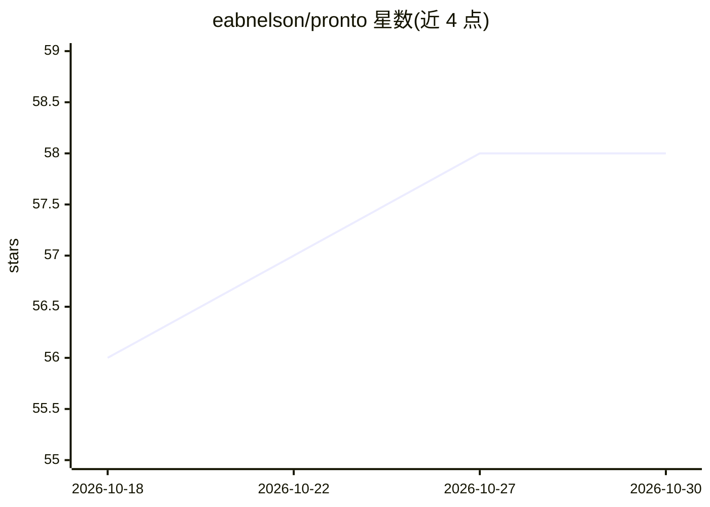

# eabnelson/pronto

⭐ 58 · TypeScript · MIT · 推送 2026-10-22 · [GitHub](https://github.com/eabnelson/pronto) · [官网](https://studiofour.io/pronto) · 个人维护

**从 iMessage/WhatsApp 对话触发本地 Codex/Claude Code 的 macOS 桥**

本地 macOS 桥接程序：监听用户已参与的 iMessage、RCS 或 WhatsApp 聊天，识别 @标签后将该条消息作为一次有界的一轮任务交给本机的 Codex 或 Claude Code CLI 处理，并以本人账号在同一聊天中回送一条纯文本回复（可附带一个文件）。支持多标签、按应用分配、每聊天记忆工作目录。以签名二进制、LaunchAgent 常驻监听与菜单栏应用形式交付；明确风险：标签即鉴权、agent 以绕过审批与沙箱的方式运行，聊天内任何参与者都可触发。

## 筛选速览

| 维度 | 判定 | 备注 |
|---|---|---|
| AI 角色 | `ai-ecosystem` | LLM/agent 周边工具 |
| 许可风险 | `permissive` | MIT |
| 部署形态 | `None` |  |
| 模型依赖 | — | README 未给出锁定关系 |
| 硬件要求 | — | 无带数字的原话,不猜 |
| 安装摩擦 | `low` | 无编译、无系统依赖或容器化 |
| 成熟度 | — | 结构信号不足 |

## 能力要点

- @标签触发本地 Codex/Claude Code CLI，单轮有界回复
- iMessage/RCS 经 imsg，WhatsApp 经 wacli（非官方 whatsmeow 协议）
- 回复可附带最高 100MB（iMessage）/20MB（WhatsApp）文件
- 签名公证的 CLI 二进制、LaunchAgent 常驻与菜单栏管理应用

## 适用场景

- 在手机聊天里 @标签 让本机编码 agent 干活并回信
- 给不同标签绑定不同用途（如 @helper、@research）
- 远程让本机 agent 在指定项目目录执行任务

## 场景标签

`编码 Agent` · 领域:编码与开发

## 证据(README 行号)

> L6: `pronto` is a small, local macOS bridge between Apple Messages or WhatsApp and
> L10: bridge gives one bounded, one-shot turn to your chosen local agent and sends one

## 星数曲线

2026-10-18 56 → 2026-10-30 58（+2）

---
*卡片 v1 · prompt 1.4 · 生成 2026-10-24 · 置信度 high · 依据 README sha `857d11c25067` · [字段定义](../../DATASET.md)*
