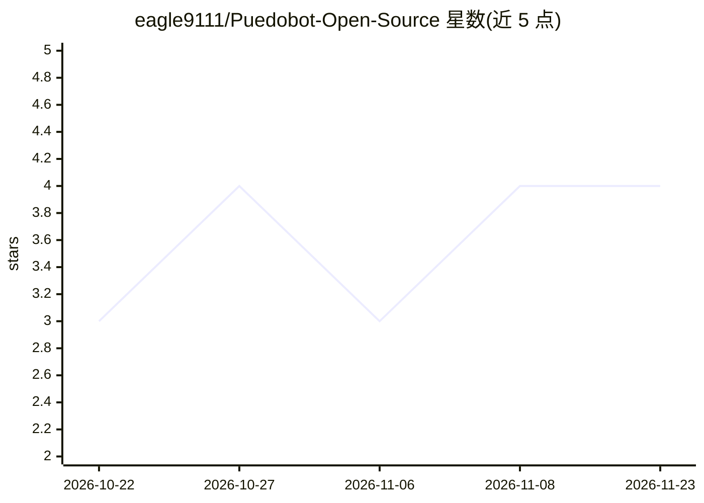

# eagle9111/Puedobot-Open-Source

⭐ 4 · Python · Apache-2.0 · 推送 2026-10-16 · [GitHub](https://github.com/eagle9111/Puedobot-Open-Source) · 个人维护

**开发者安全审计工具：多引擎 SAST 加双重 AI 复核排除误报**

面向开发团队的静态分析安全审计器（SAST）：先用确定性引擎（AST 遍历、Bandit、Semgrep、OSV CVE 情报、git 历史密钥扫描）定位可疑代码点，再经两阶段 AI 复核（Triage Scout 评估可利用性、Skeptical Verifier 反驳误报）后输出带置信度的发现清单。模型不可知，可接入任意云端 LLM 或以本地模型离线运行；发现存储于 PostgreSQL，通过交互式 CLI 展示与人工复核。

## 筛选速览

| 维度 | 判定 | 备注 |
|---|---|---|
| AI 角色 | `ai-native` | 本体是模型或模型工具 |
| 许可风险 | `permissive` | Apache-2.0 |
| 部署形态 | `self-host` | docker 或自建部署 |
| 模型依赖 | local-ok | 支持本地模型 |
| 硬件要求 | — | 无带数字的原话,不猜 |
| 安装摩擦 | `low` | 无编译、无系统依赖或容器化 |
| 成熟度 | — | 结构信号不足 |

## 能力要点

- AST/Bandit/Semgrep/OSV 多引擎单次扫描
- 两阶段 AI 复核：可利用性分析后接反驳式误报消除
- 模型不可知：支持云端 LLM 或 Ollama/vLLM 本地推理，可完全离线
- git 历史中检测 API 密钥、证书等泄露并自动正则脱敏

## 适用场景

- 提交前或 CI/CD 流程中对代码库做安全审计质量门禁
- 排除传统 SAST 工具的大量误报，只复核可疑点
- 在离线/内网环境下对私有代码做不外泄的安全扫描

## 场景标签

`网络安全` `代码审查` · 领域:编码与开发

## 证据(README 行号)

> L8: **Developer-first static analysis security auditor (SAST) with dual-pass skeptical AI false-alarm elimination.**
> L14: 2. **Dual-Pass AI Triage**: Quarantines suspicious code snippets and evaluates them through a two-phase challenger 
> L24: - **🌐 Universal Model Compatibility**: Completely model-agnostic. Plug in DeepSeek, OpenAI, Gemini, Groq, or self-h

## 星数曲线

2026-10-22 3 → 2026-11-23 4（+1）

---
*卡片 v1 · prompt 1.4 · 生成 2026-11-21 · 置信度 mid · 依据 README sha `374d806248b0` · [字段定义](../../DATASET.md)*
