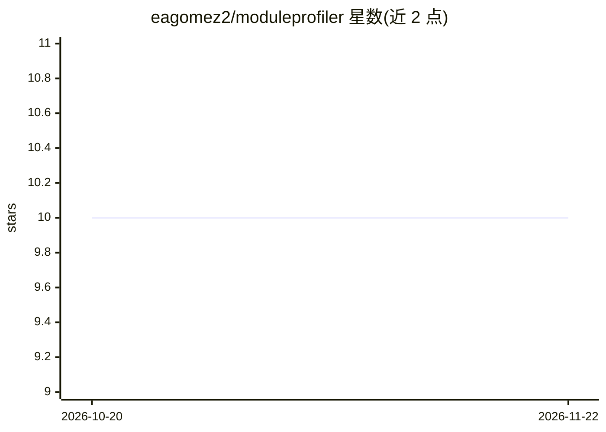

# eagomez2/moduleprofiler

⭐ 10 · Python · CC-BY-SA-4.0 · 推送 2026-06-22 · [GitHub](https://github.com/eagomez2/moduleprofiler) · [官网](https://eagomez2.github.io/moduleprofiler/) · 个人维护

**开发期剖析 PyTorch 模型参数/运算量/耗时的 Python 包**

面向开发阶段的 torch.nn.Module 剖析工具：统计模型参数量、追踪各组件输入输出尺寸、估算前向传播运算次数、测量逐模块与整体推理耗时。结果可输出为 dict、pandas.DataFrame、HTML 或 LaTeX（便于写入论文）。作为常规 Python 模块从 PyPI 或本仓库安装，文档可用 mkdocs 本地运行。由阿尔托大学语音交互技术组的 Esteban Gómez 开发。

## 筛选速览

| 维度 | 判定 | 备注 |
|---|---|---|
| AI 角色 | `ai-native` | 本体是模型或模型工具 |
| 许可风险 | `viral` | CC-BY-SA-4.0 |
| 部署形态 | `library` | 以包/库形式分发 |
| 模型依赖 | — | README 未给出锁定关系 |
| 硬件要求 | — | 无带数字的原话,不猜 |
| 安装摩擦 | `low` | 无编译、无系统依赖或容器化 |
| 成熟度 | — | 结构信号不足 |

## 能力要点

- 统计参数量、追踪各模块输入输出尺寸
- 估算前向传播运算次数并测量推理时间
- 输出 dict/DataFrame/HTML/LaTeX 四种格式
- 提供在线文档与 mkdocs 本地文档

## 适用场景

- 开发期评估模型是否符合参数量与算力约束
- 论文中生成模型复杂度表格（LaTeX 输出）
- 定位模型中各组件的耗时占比

## 场景标签

 · 领域:机器学习开发工具

## 证据(README 行号)

> L2: Free open-source package to profile `torch.nn.Module` modules and obtain useful information to design a model that f
> L5: - Calculate the number of parameters of your model.

## 星数曲线

2026-10-20 10 → 2026-11-22 10（+0）

---
*卡片 v1 · prompt 1.4 · 生成 2026-11-19 · 置信度 high · 依据 README sha `cd11e93d26c0` · [字段定义](../../DATASET.md)*
