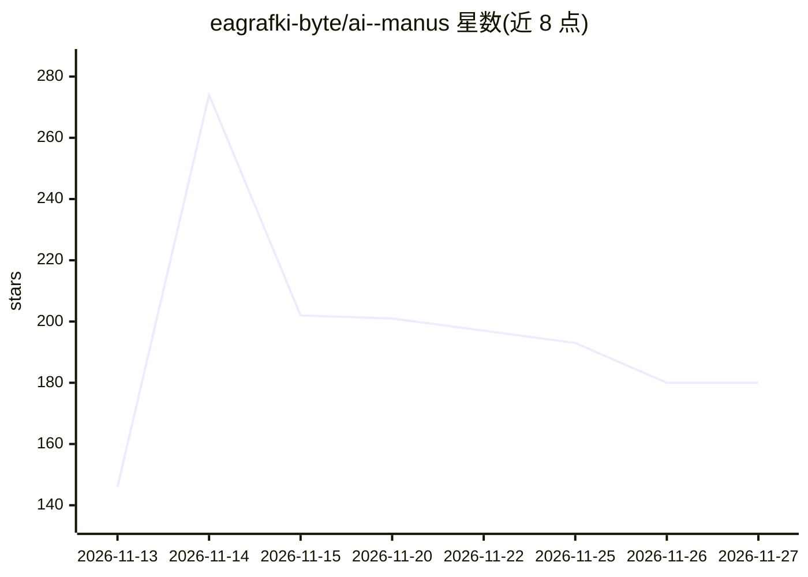

# eagrafki-byte/ai--manus

⭐ 180 · Apache-2.0 · 推送 2026-11-14 · [GitHub](https://github.com/eagrafki-byte/ai--manus) · 个人维护

**面向个人用户的自主 AI Agent：自动执行代码与浏览器操作**

README 描述 Manus 为可代用户运行代码并控制浏览器的自主 AI agent：写脚本并执行、打开网页与页面元素交互、跨脚本与浏览器完成多步骤任务，可跨会话重复应用已学的工作流模式。定位为家庭、学习与轻量工作场景的助手，非企业平台。README 提供硬件兼容表（最低双核 CPU/4GB 内存），但未给出安装命令、源码结构或模型接入方式等可验证的实现细节，内容以功能宣传为主。

## 筛选速览

| 维度 | 判定 | 备注 |
|---|---|---|
| AI 角色 | `ai-native` | 本体是模型或模型工具 |
| 许可风险 | `permissive` | Apache-2.0 |
| 部署形态 | `None` |  |
| 模型依赖 | — | README 未给出锁定关系 |
| 硬件要求 | — | 无带数字的原话,不猜 |
| 安装摩擦 | `low` | 无编译、无系统依赖或容器化 |
| 成熟度 | — | 结构信号不足 |

## 能力要点

- 自主执行代码与脚本运行
- 浏览器控制：导航页面、填表、采集信息
- 代码与浏览器操作可在同一任务流中衔接
- 面向家庭/学习/轻量工作的小规模场景

## 适用场景

- 让 agent 代为完成重复的网页查资料与填表工作
- 运行小脚本和快速计算实验
- 整理研究笔记与文件、安排日常小任务

## 场景标签

`浏览器自动化` `AI 助手` · 领域:效率与自动化

## 证据(README 行号)

> L10: - **Autonomous Code Execution:** Manus AI agent runs code on its own to complete tasks, so you can focus on decisio
> L18: Manus is an autonomous AI agent designed to run code and control a browser on your behalf. Instead of acting like a

## 星数曲线

2026-11-13 146 → 2026-11-27 180（+34）

---
*卡片 v1 · prompt 1.4 · 生成 2026-11-17 · 置信度 mid · 依据 README sha `4347b4dd3fa7` · [字段定义](../../DATASET.md)*
