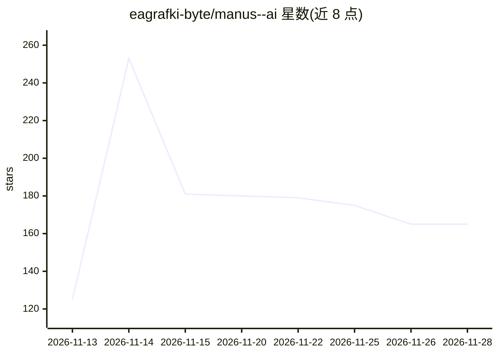

# eagrafki-byte/manus--ai

⭐ 165 · Apache-2.0 · 推送 2026-11-14 · [GitHub](https://github.com/eagrafki-byte/manus--ai) · 个人维护

**面向个人用户的自主 AI Agent：代为执行代码与浏览器操作**

Manus 定位为自主 AI Agent，README 描述其可代替用户编写并执行脚本、控制浏览器完成页面导航、表单填写与信息收集，并可跨代码与浏览器串联多步任务，面向学习、家庭与轻量办公场景。仓库描述补充其在沙箱环境中运行多种工具与操作，涉及 OpenAI、Anthropic 等多模型生态标签。README 为营销式说明，未提供安装命令、源码结构或使用文档，仅给出硬件兼容表与泛化的上手步骤，实际可用性无法从 README 验证。

## 筛选速览

| 维度 | 判定 | 备注 |
|---|---|---|
| AI 角色 | `ai-native` | 本体是模型或模型工具 |
| 许可风险 | `permissive` | Apache-2.0 |
| 部署形态 | `None` |  |
| 模型依赖 | — | README 未给出锁定关系 |
| 硬件要求 | — | 无带数字的原话,不猜 |
| 安装摩擦 | `low` | 无编译、无系统依赖或容器化 |
| 成熟度 | — | 结构信号不足 |

## 能力要点

- 自主执行代码与控制浏览器完成多步任务
- 代码与浏览器操作可在同一任务流中衔接
- 跨会话记忆工作流模式并复用
- 沙箱环境中运行工具与操作（仓库描述）

## 适用场景

- 让学生整理研究笔记、跑小型脚本
- 代替人工在多网页收集信息、填重复表单
- 日常小型项目里委派重复性事务给后台 agent

## 场景标签

`浏览器自动化` `AI 助手` · 领域:效率与自动化

## 证据(README 行号)

> L10: - **Autonomous Code Execution:** Manus AI agent runs code on its own to complete tasks, so you can focus on decisio
> L18: Manus is an autonomous AI agent designed to run code and control a browser on your behalf. Instead of acting like a

## 星数曲线

2026-11-13 125 → 2026-11-28 165（+40）

---
*卡片 v1 · prompt 1.4 · 生成 2026-11-17 · 置信度 mid · 依据 README sha `885ad01e4b6b` · [字段定义](../../DATASET.md)*
