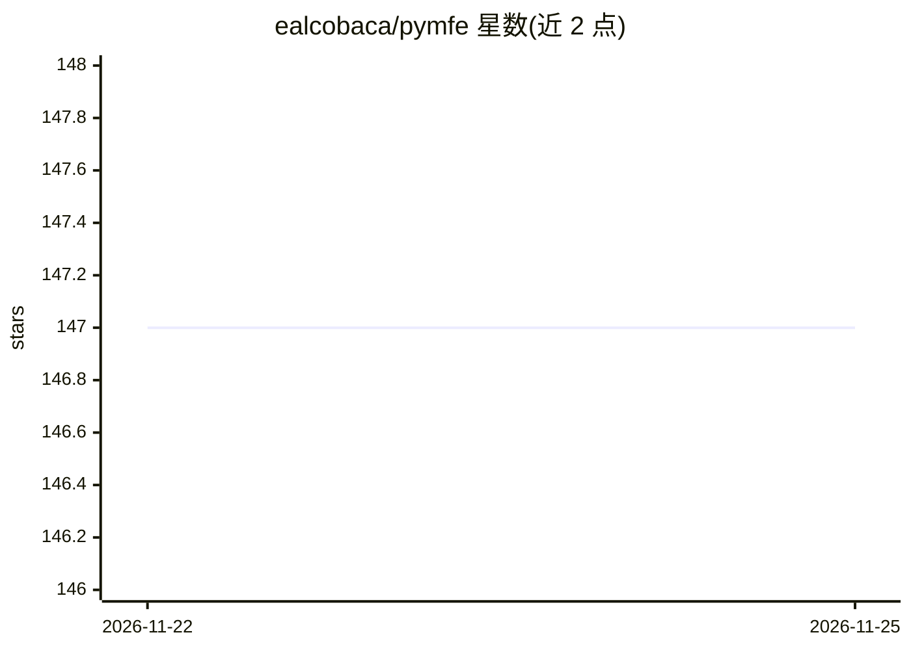

# ealcobaca/pymfe

⭐ 147 · Python · MIT · 推送 2026-11-20 · [GitHub](https://github.com/ealcobaca/pymfe) · [官网](https://pymfe.readthedocs.io) · 组织维护

**为机器学习研究者提供数据集元特征提取的 Python 库**

pymfe 是一个 Python 元特征提取库，按 General、Statistical、Information-theoretic、Model-based、Landmarking、Clustering、Concept 等 10 个组实现元特征，用于刻画数据集特征。支持自定义度量与汇总函数（如 mean/median/min/max）及超参数设置、从已训练的 sklearn 模型提取元特征、bootstrap 置信区间估计、自动计时。面向 Meta-learning 与 AutoML 任务，依赖 Python>=3.6，通过 pip 或源码安装。

## 筛选速览

| 维度 | 判定 | 备注 |
|---|---|---|
| AI 角色 | `ai-native` | 本体是模型或模型工具 |
| 许可风险 | `permissive` | MIT |
| 部署形态 | `library` | 以包/库形式分发 |
| 模型依赖 | — | README 未给出锁定关系 |
| 硬件要求 | — | 无带数字的原话,不猜 |
| 安装摩擦 | `low` | 无编译、无系统依赖或容器化 |
| 成熟度 | — | 结构信号不足 |

## 能力要点

- 提供 10 组元特征（General/Statistical/Landmarking/Complexity 等）
- 支持从预训练 sklearn 模型直接提取元特征（extract_from_model）
- bootstrap 置信区间提取与多种汇总函数（mean/median/min/max/峰度等）
- 支持监督与无监督任务，自动选取适用的元特征

## 适用场景

- 为 AutoML 系统生成数据集的元特征表示
- Meta-learning 研究中刻画与比较数据集
- 为算法推荐系统构建数据集特征

## 场景标签

 · 领域:机器学习/AutoML

## 证据(README 行号)

> L9: The pymfe (**py**thon **m**eta-**f**eature **e**xtractor) provides a
> L51: In this package, We provided the following meta-features groups:
> L30: Meta-features are used in MtL and AutoML tasks in general, to

## 星数曲线

2026-11-22 147 → 2026-11-25 147（+0）

---
*卡片 v1 · prompt 1.4 · 生成 2026-11-22 · 置信度 high · 依据 README sha `f800d7a6e425` · [字段定义](../../DATASET.md)*
