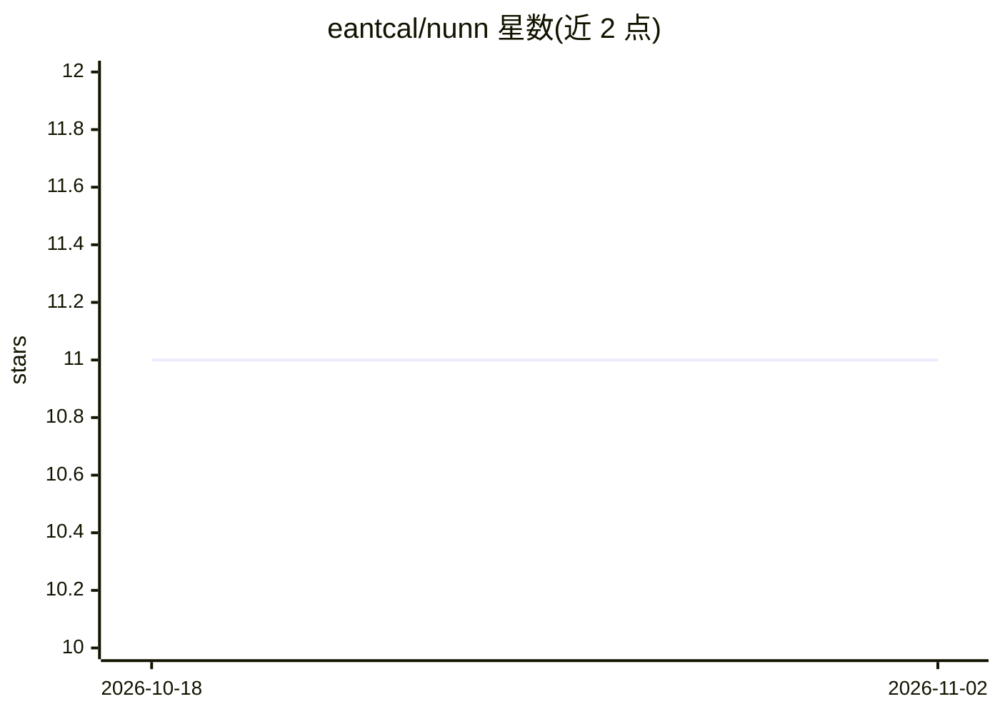

# eantcal/nunn

⭐ 11 · C++ · MIT · 推送 2026-08-07 · [GitHub](https://github.com/eantcal/nunn) · [官网](http://www.eantcal.eu) · 个人维护

**C++20 机器学习算法库：从感知机到 Transformer 的可读实现**

MIT 许可的 C++20 机器学习库，以可读、可学习的代码库为目标，面向用现代 C++ 实验神经网络与机器学习算法的开发者。实现覆盖感知机、MLP、Eigen 支撑的矩阵版 MLP（mini-batch SGD/Adam，可选 ArrayFire/OpenCL 加速）、Elman RNN/GRU/LSTM（截断 BPTT）、Hopfield、自编码器、RBF、1D 卷积网络、decoder-only MiniTransformer 以及 DQN/Q-learning/SARSA。含 342 个 GoogleTest 单元测试，CMake 构建，依赖 Eigen 3.4 与 nlohmann/json 通过 FetchContent 自动获取。附带配套书籍与 GitHub Wiki 文档。

## 筛选速览

| 维度 | 判定 | 备注 |
|---|---|---|
| AI 角色 | `ai-native` | 本体是模型或模型工具 |
| 许可风险 | `permissive` | MIT |
| 部署形态 | `None` |  |
| 模型依赖 | — | README 未给出锁定关系 |
| 硬件要求 | — | 无带数字的原话,不猜 |
| 安装摩擦 | `medium` | 含编译或系统依赖之一 |
| 成熟度 | — | 结构信号不足 |

## 能力要点

- 覆盖感知机/MLP/RNN(GRU/LSTM)/Hopfield/自编码器/RBF/1D 卷积/MiniTransformer/DQN 等多种算法
- Eigen 3.4 矩阵后端，mini-batch SGD/Adam，可选 ArrayFire/OpenCL 加速
- 342 个 GoogleTest 单元测试，跨 Windows/Linux/macOS
- MNIST 演示（784→300→10，约 98% 准确率）

## 适用场景

- 用现代 C++ 学习和实验各类神经网络算法
- 在 C++ 项目中嵌入小型神经网络训练与推理
- 作为教材配套代码理解算法实现细节

## 场景标签

`强化学习` · 领域:训练与推理

## 证据(README 行号)

> L3: **Nunn** is a free and open-source machine learning library written in **C++20**, distributed under the **MIT Licens
> L9: ## Features

## 星数曲线

2026-10-18 11 → 2026-11-02 11（+0）

---
*卡片 v1 · prompt 1.4 · 生成 2026-11-02 · 置信度 high · 依据 README sha `337eb89ef623` · [字段定义](../../DATASET.md)*
