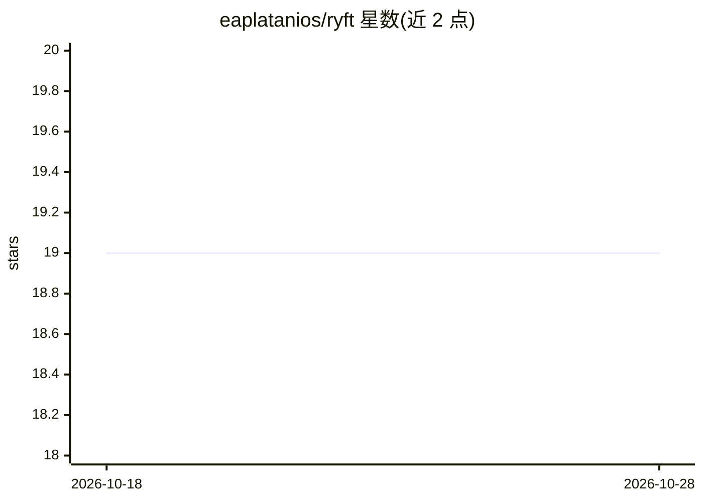

# eaplatanios/ryft

⭐ 19 · Rust · Apache-2.0 · 推送 2026-10-28 · [GitHub](https://github.com/eaplatanios/ryft) · 个人维护

**Rust 的 ML 系统构建框架：追踪、自动微分与 JIT 编译**

受 JAX 启发的 Rust 库，为机器学习系统提供类型安全的计算追踪、自动微分与即时编译，以利用硬件加速器。顶层 ryft 为伞形 crate，包含 ryft-core（尚处早期、仅 Parameterized API 较完整）、ryft-macros、XLA 后端 ryft-xla，以及 MLIR/PJRT/XLA 的高层与 -sys 绑定。默认启用 xla feature，支持 cuda-12/13、rocm、tpu、metal 等加速器特性。README 声明项目仍在活跃开发中，API 与 crate 边界可能变动。

## 筛选速览

| 维度 | 判定 | 备注 |
|---|---|---|
| AI 角色 | `ai-ecosystem` | LLM/agent 周边工具 |
| 许可风险 | `permissive` | Apache-2.0 |
| 部署形态 | `None` |  |
| 模型依赖 | — | README 未给出锁定关系 |
| 硬件要求 | — | 无带数字的原话,不猜 |
| 安装摩擦 | `medium` | 含编译或系统依赖之一 |
| 成熟度 | `idea` | |

## 能力要点

- 类型安全的追踪、自动微分与 JIT 编译
- XLA 后端与 MLIR/PJRT 的 Rust 绑定
- cuda-12/13、rocm-7、tpu、neuron、metal、mps 等加速器 feature flags
- 伞形 crate 结构，单一入口 re-export 各子 crate 功能

## 适用场景

- 在 Rust 中构建可自动微分并 JIT 编译的 ML 计算
- 通过 Rust 绑定直接操作 MLIR/PJRT 构建 StableHLO 程序
- 面向 GPU/TPU 等加速器运行编译后的计算图

## 场景标签

 · 领域:机器学习框架/编译器基础设施

## 证据(README 行号)

> L6: `ryft` is a Rust library for building machine learning systems that is inspired by
> L11: - **`ryft-core`:** Intended home for core tracing, automatic differentiation, and Just-In-Time (JIT) compilation. T
> L17:  - **`ryft-xla`:** XLA backend for `ryft`.

## 星数曲线

2026-10-18 19 → 2026-10-28 19（+0）

---
*卡片 v1 · prompt 1.4 · 生成 2026-10-28 · 置信度 high · 依据 README sha `ccc46934ba73` · [字段定义](../../DATASET.md)*
