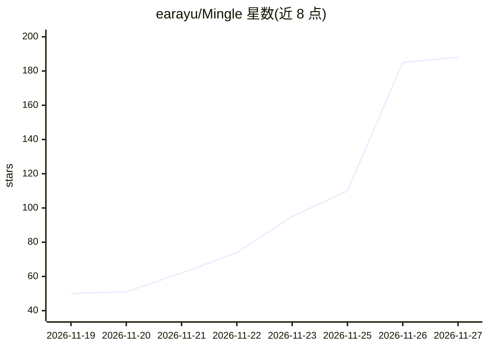

# earayu/Mingle

⭐ 188 · TypeScript · MIT · 推送 2026-11-26 · [GitHub](https://github.com/earayu/Mingle) · [官网](https://mingle.build/) · 个人维护 · 中文 README

**把已有的 coding agent 以机器人身份接入常用聊天应用，本地运行**

Mingle 是一个本地运行的程序：用户在自己电脑上创建一个有名字、角色、记忆文件（ROLE.md/MEMORY.md）与主目录的 agent，由已有的 coding agent（如 Claude Code、Codex）驱动，并通过各聊天应用的官方 bot API 将其接入飞书、微信、Slack、Telegram、Discord 等渠道，支持 @-mention 派任务、线程进度与提醒。无服务器、无账号、无遥测，控制台仅监听 127.0.0.1。提供桌面应用安装与 Node.js 24 + pnpm 源码运行两条路径；README 自述处于早期开发，仅部分 harness 与飞书经真实环境验证。

## 筛选速览

| 维度 | 判定 | 备注 |
|---|---|---|
| AI 角色 | `ai-ecosystem` | LLM/agent 周边工具 |
| 许可风险 | `permissive` | MIT |
| 部署形态 | `library` | 以包/库形式分发 |
| 模型依赖 | — | README 未给出锁定关系 |
| 硬件要求 | — | 无带数字的原话,不猜 |
| 安装摩擦 | `low` | 无编译、无系统依赖或容器化 |
| 成熟度 | `idea` | |

## 能力要点

- 一个 agent 同时接入多个聊天应用并共享 MEMORY.md 记忆
- 复用用户已订阅的 harness，不新增模型与账单
- 无服务器架构：数据留在本机，凭据存于 macOS Keychain/Windows DPAPI/Linux Secret Service
- 桌面应用常驻菜单栏/托盘，支持开机启动与自更新

## 适用场景

- 在微信/飞书/Slack 群里 @ 机器人派发任务并收回结果
- 让同一个 agent 跨聊天应用记忆上下文、代为传消息
- 给聊天群里的 agent 配置定时任务与提醒

## 场景标签

`聊天机器人` · 领域:对话与助手

## 证据(README 行号)

> L7: **Bring your agent companion into the chat apps you already use. Runs on your machine, no server.**
> L19: Create an agent on your own computer: it has a name, a role, a memory and a home directory, and a coding agent you 
> L72: - Mingle receives messages through each chat app's official bot API and hands them to the agent's single, long-live

## 星数曲线

2026-11-19 50 → 2026-11-27 188（+138）

---
*卡片 v1 · prompt 1.4 · 生成 2026-11-27 · 置信度 mid · 依据 README sha `1977dc4787cb` · [字段定义](../../DATASET.md)*
