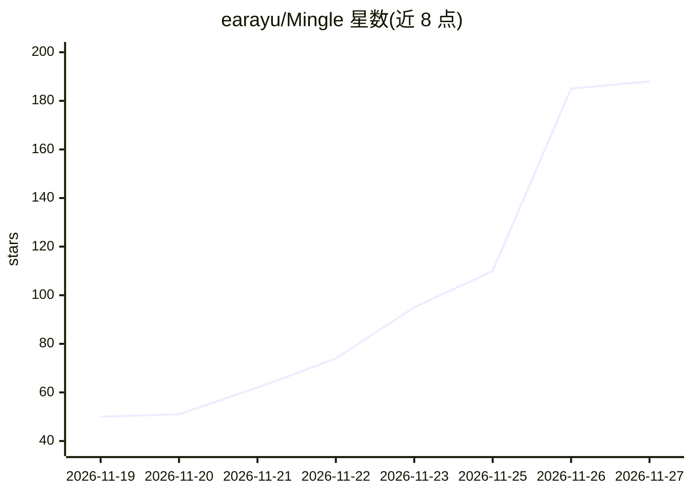

# earayu/Mingle

⭐ 188 · TypeScript · MIT · 推送 2026-11-26 · [GitHub](https://github.com/earayu/Mingle) · [官网](https://mingle.build/) · 个人维护 · 中文 README

**把你现有的 coding agent 接入聊天应用的本地运行层**

Mingle 在本地机器上创建具名、有角色与记忆目录的 agent，由 Claude Code、Codex 等已有 harness 驱动，使其以 bot 身份进入微信、飞书、Slack、Telegram 等聊天应用，支持 @ 提及、任务委派、多会话并行与跨应用共享 MEMORY.md。消息经各应用官方 bot API 接入，无云端桥接，凭据存于系统密钥服务，控制台仅监听 127.0.0.1。提供桌面安装包与源码运行（Node.js 24 + pnpm），暂不接受 PR。

## 筛选速览

| 维度 | 判定 | 备注 |
|---|---|---|
| AI 角色 | `ai-ecosystem` | LLM/agent 周边工具 |
| 许可风险 | `permissive` | MIT |
| 部署形态 | `library` | 以包/库形式分发 |
| 模型依赖 | — | README 未给出锁定关系 |
| 硬件要求 | — | 无带数字的原话,不猜 |
| 安装摩擦 | `low` | 无编译、无系统依赖或容器化 |
| 成熟度 | `idea` | |

## 能力要点

- 同一 agent 跨多个聊天应用同时在线并共享一份 MEMORY.md
- 复用已有的 harness 与订阅，自身不增加模型与账单
- 本地运行、无服务器、无遥测，凭据存于 macOS Keychain/Windows DPAPI/Linux Secret Service
- 支持 WeChat、飞书、钉钉、QQ、Slack、Discord、Telegram、iMessage、GitHub issues/PR 等渠道

## 适用场景

- 在团队飞书群和家人微信群用同一个 agent 处理不同事务
- 在聊天中 @ 机器人委派耗时任务，完成后在原消息下回复
- 让 agent 在 Slack 与 Telegram 之间传递消息

## 场景标签

`聊天机器人` `编码 Agent` · 领域:编码与开发

## 证据(README 行号)

> L17: Create an agent on your own computer: it has a name, a role, a memory and a home directory, and a coding agent you 
> L30: |**Harnesses**|Claude Code, Codex, Cursor, OpenCode, Kimi Code, Grok Build, Qwen Code, Qoder, CodeBuddy Code, DeepS
> L70: - Mingle receives messages through each chat app's official bot API and hands them to the agent's single, long-live

## 星数曲线

2026-11-19 50 → 2026-11-27 188（+138）

---
*卡片 v1 · prompt 1.4 · 生成 2026-11-26 · 置信度 mid · 依据 README sha `8d29b9ee145c` · [字段定义](../../DATASET.md)*
