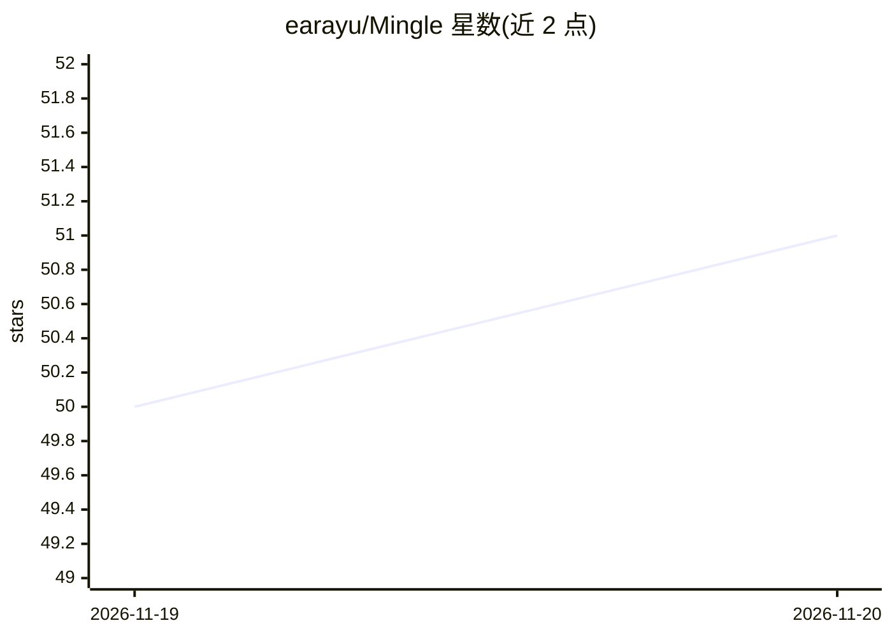

# earayu/Mingle

⭐ 51 · TypeScript · MIT · 推送 2026-11-19 · [GitHub](https://github.com/earayu/Mingle) · [官网](https://mingle.build/) · 个人维护 · 中文 README

**把本地 agent 接入既有聊天应用的桥接工具**

在个人电脑上运行的工具：为本地的编码 agent（harness）创建名称、角色、记忆与主目录，并通过各聊天应用的官方 bot API 让 agent 以机器人形式加入群聊与私聊，可跨多个聊天应用共享同一记忆。无服务端、无账号、无遥测，控制台与 API 仅监听 127.0.0.1；bot 凭据存于系统密钥库。提供桌面应用（macOS 签名公证，Windows 未签名）与源码运行方式；需已有的 harness 订阅，README 自述处于早期开发阶段。

## 筛选速览

| 维度 | 判定 | 备注 |
|---|---|---|
| AI 角色 | `ai-ecosystem` | LLM/agent 周边工具 |
| 许可风险 | `permissive` | MIT |
| 部署形态 | `library` | 以包/库形式分发 |
| 模型依赖 | — | README 未给出锁定关系 |
| 硬件要求 | — | 无带数字的原话,不猜 |
| 安装摩擦 | `low` | 无编译、无系统依赖或容器化 |
| 成熟度 | `idea` | |

## 能力要点

- 一个 agent 同时接入多个聊天应用并共享单一记忆
- 复用用户已有的 harness 与订阅，Mingle 自身不提供模型
- 数据留在本地：无服务端、无账号、无遥测，控制台仅监听 127.0.0.1
- agent 具备任务、提醒、通讯录、跨群转信等命令

## 适用场景

- 让 agent 在飞书工作群、微信家庭群、Discord 服务器中同时值守
- 通过微信或 Telegram 远程向本地 agent 下达任务
- 跨聊天应用转发消息与查询其他群的决策记录

## 场景标签

`聊天机器人` · 领域:对话与助手

## 证据(README 行号)

> L9: Create an agent on your own computer: it has a name, a role, a memory and a home directory, and a coding agent you a
> L21: |**Harnesses**|Claude Code, Codex, Cursor, OpenCode, Kimi Code, Grok Build, Qwen Code, Qoder, CodeBuddy Code, DeepS
> L61: - Mingle receives messages through each chat app's official bot API and hands them to the agent's single, long-live

## 星数曲线

2026-11-19 50 → 2026-11-20 51（+1）

---
*卡片 v1 · prompt 1.4 · 生成 2026-11-19 · 置信度 mid · 依据 README sha `aba15c08fb2d` · [字段定义](../../DATASET.md)*
