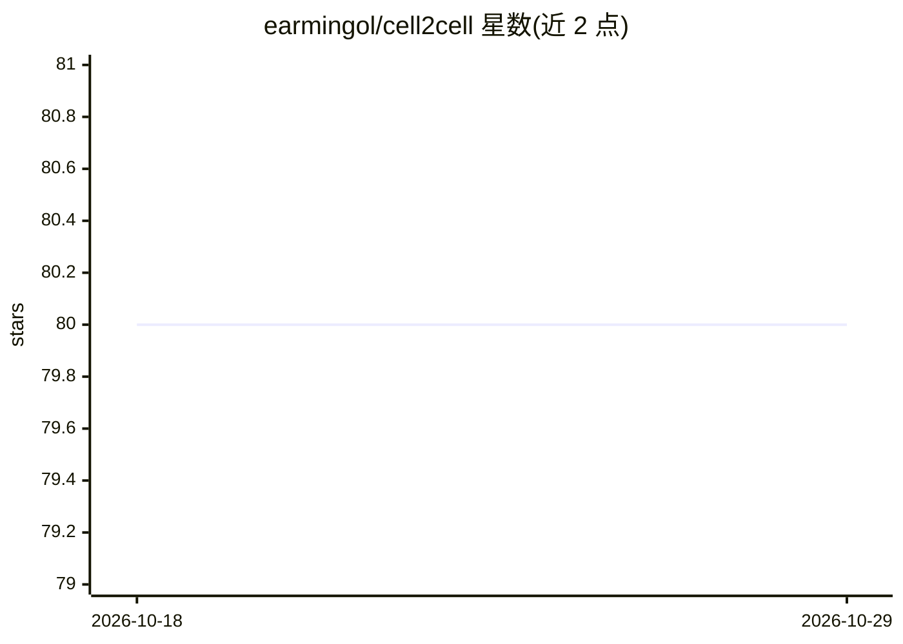

# earmingol/cell2cell

⭐ 80 · Python · BSD-3-Clause · 推送 2026-09-20 · [GitHub](https://github.com/earmingol/cell2cell) · 组织维护

**从基因表达推断细胞间通讯的分析工具**

Python 工具，读取相互作用蛋白的基因表达数据（bulk 或单细胞 RNA-seq），推断细胞间相互作用与通讯；提供 cell2cell 交互分析管线与 Tensor-cell2cell 张量分解通讯模式分析，含配体-受体对清单与遗传算法示例。面向生物信息学研究者，通过 Anaconda + pip 安装，支持 Google Colab GPU 运行示例；张量分解在内存不足时建议改用 random 初始化。

## 筛选速览

| 维度 | 判定 | 备注 |
|---|---|---|
| AI 角色 | `ai-native` | 本体是模型或模型工具 |
| 许可风险 | `permissive` | BSD-3-Clause |
| 部署形态 | `library` | 以包/库形式分发 |
| 模型依赖 | — | README 未给出锁定关系 |
| 硬件要求 | — | 无带数字的原话,不猜 |
| 安装摩擦 | `low` | 无编译、无系统依赖或容器化 |
| 成熟度 | — | 结构信号不足 |

## 能力要点

- 支持 bulk 与单细胞 RNA-seq 数据的细胞间通讯推断
- Tensor-cell2cell 张量分解识别通讯模式（可 GPU）
- 配体-受体对空间代码示例采用遗传算法
- 提供配体-受体对整理清单与 LIANA 教程

## 适用场景

- 分析单细胞数据的细胞间通讯模式
- 识别配体-受体对的空间代码
- 结合 LIANA 做多样本细胞通讯分析

## 场景标签

 · 领域:生物信息学/计算生物学

## 证据(README 行号)

> L1: # Inferring cell-cell interactions from transcriptomes with *cell2cell*
> L37: |- Step-by-step Pipeline - Interaction Pipeline for Bulk Data - Interaction Pipeline for Single-Cell Data - Whole B

## 星数曲线

2026-10-18 80 → 2026-10-29 80（+0）

---
*卡片 v1 · prompt 1.4 · 生成 2026-10-24 · 置信度 high · 依据 README sha `821f26277e86` · [字段定义](../../DATASET.md)*
