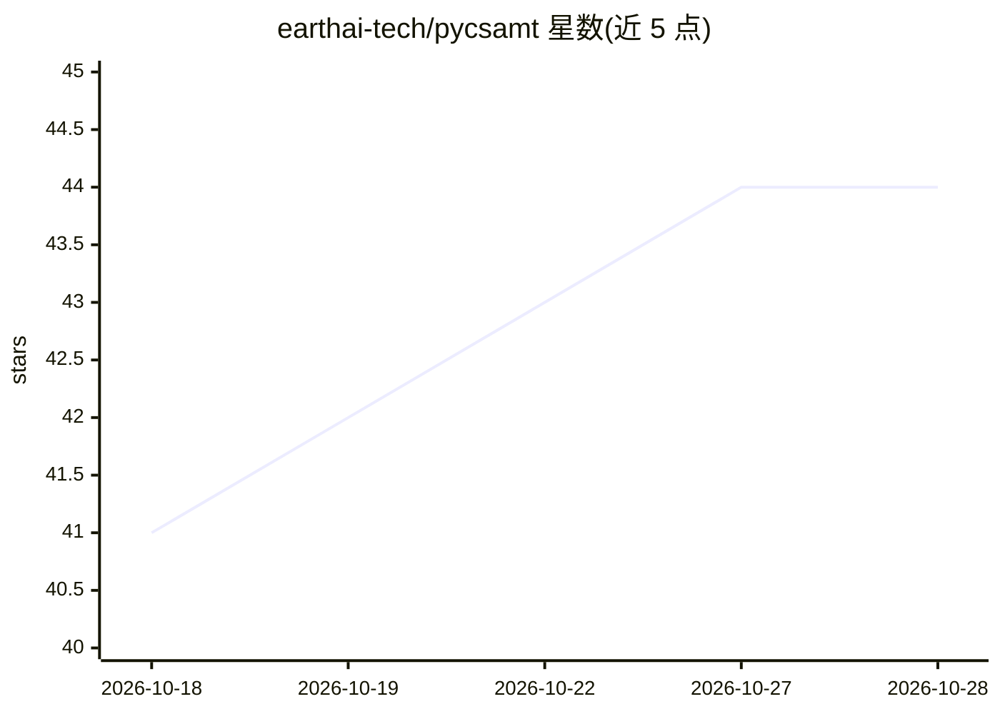

# earthai-tech/pycsamt

⭐ 44 · Python · LGPL-3.0 · 推送 2026-10-02 · [GitHub](https://github.com/earthai-tech/pycsamt) · [官网](https://pycsamt.org) · 组织维护

**电磁法地球物理全流程工具包：数据处理到反演与解释**

面向 CSAMT/AMT/MT/TDEM 电磁地球物理的 Python 工具包，覆盖数据 I/O 与质检、野外观测遥测、25 种处理校正方法、正演建模、Occam2D/ModEM/MARE2DEM 经典反演及 PINN/混合深度学习反演器、解释成图。另含 LLM 驱动的 agent（Anthropic/OpenAI/Gemini）、Web 仪表盘与桌面 GUI。以 pip 安装为核心，桌面套件为独立安装包（30 天全功能试用），需 Python 3.9+。

## 筛选速览

| 维度 | 判定 | 备注 |
|---|---|---|
| AI 角色 | `ai-enhanced` | 去掉 AI 部分产品仍成立 |
| 许可风险 | `viral` | LGPL-3.0 |
| 部署形态 | `desktop` | 安装包/桌面程序 |
| 模型依赖 | — | README 未给出锁定关系 |
| 硬件要求 | — | 无带数字的原话,不猜 |
| 安装摩擦 | `low` | 无编译、无系统依赖或容器化 |
| 成熟度 | — | 结构信号不足 |

## 能力要点

- EDI/AVG/TDEM/MARE2DEM 等多格式数据 I/O 与频率审计
- 25 种处理校正方法（静校正、相位张量分析等）
- 经典 Occam2D/ModEM/MARE2DEM 与 PINN/混合深度学习反演器
- YAML/JSON 可复现流水线与 LLM 驱动 agent、CLI/Web/桌面四种界面

## 适用场景

- 电磁勘探数据从原始文件处理到反演与出图的完整流程
- 用 PINN 或混合深度学习方法做地球物理反演
- 野外台站遥测数据边缘质检后直接进入处理流水线
- 通过自然语言让 AI agent 执行处理任务

## 场景标签

 · 领域:地球物理/科学计算

## 证据(README 行号)

> L28: **pyCSAMT v2** is a full-lifecycle toolkit for controlled-source and
> L54: - 🧠 **AI-assisted processing & inversion** — learned denoising, gap-filling,

## 星数曲线

2026-10-18 41 → 2026-10-28 44（+3）

---
*卡片 v1 · prompt 1.4 · 生成 2026-10-25 · 置信度 high · 依据 README sha `d863a65217ac` · [字段定义](../../DATASET.md)*
