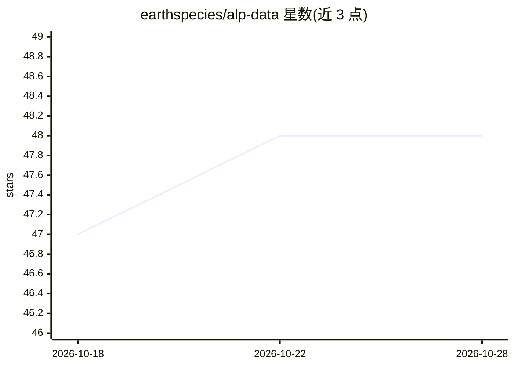

# earthspecies/alp-data

⭐ 48 · Python · MIT · 推送 2026-10-27 · [GitHub](https://github.com/earthspecies/alp-data) · 组织维护

**统一 Python 接口访问 35+ 生物声学数据集的加载库**

alp-data（Animal Language Processing data）为生物声学研究者提供 35+ 内置数据集的统一 Dataset 接口：涵盖鸟类、海洋哺乳动物、灵长类、昆虫、无尾两栖类及多类群基准（BEANS、BirdSet、Watkins 等），统一 audio/sample_rate 键、采样率协调、标签派生与 split 感知加载。内置数据集从公共 Cloudflare R2 桶流式加载，也支持本地/GCS/S3 读取；支持流式模式、可配置 transform、数据集拼接合并与 pandas/polars 可插拔后端。限制：PyTorch DataLoader 多 worker 时必须用 spawn 启动方式。

## 筛选速览

| 维度 | 判定 | 备注 |
|---|---|---|
| AI 角色 | `ai-ecosystem` | LLM/agent 周边工具 |
| 许可风险 | `permissive` | MIT |
| 部署形态 | `library` | 以包/库形式分发 |
| 模型依赖 | — | README 未给出锁定关系 |
| 硬件要求 | — | 无带数字的原话,不猜 |
| 安装摩擦 | `low` | 无编译、无系统依赖或容器化 |
| 成熟度 | — | 结构信号不足 |

## 能力要点

- 35+ 内置数据集共享统一 Dataset 接口
- 流式模式可处理超过内存的数据集
- YAML 配置加载数据集与 transform
- pandas/polars 可插拔后端与多源 I/O（本地/GCS/S3/R2）

## 适用场景

- 跨类群搭建生物声学多数据集基准
- 流式读取特定物种音频做迁移学习
- 用统一接口比较模型在不同声学数据集上的表现

## 场景标签

 · 领域:生物声学/机器学习数据基础设施

## 证据(README 行号)

> L5: **alp-data** (Animal Language Processing data) gives you unified access to dozens of bioacoustic datasets, including
> L13: You can stand up a multi-dataset benchmark, compare models across taxa, or stream species-specific audio for transf
> L17: alp-data ships with 35+ built-in datasets across:

## 星数曲线

2026-10-18 47 → 2026-10-28 48（+1）

---
*卡片 v1 · prompt 1.4 · 生成 2026-10-25 · 置信度 high · 依据 README sha `aeae08611120` · [字段定义](../../DATASET.md)*
