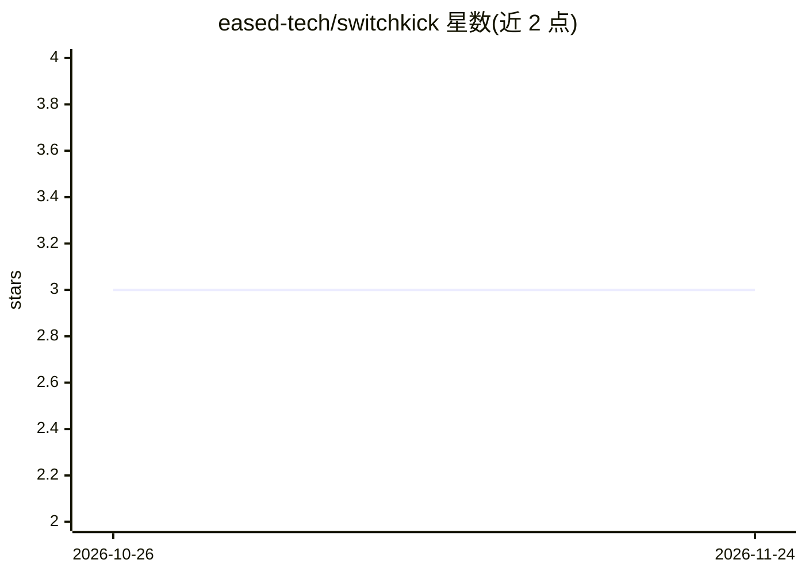

# eased-tech/switchkick

⭐ 3 · TypeScript · Apache-2.0 · 推送 2026-11-23 · [GitHub](https://github.com/eased-tech/switchkick) · 组织维护

**给 coding agents 用的本地代理：经 OpenRouter 逐轮路由模型**

switchkick 是面向 coding agents 与 OpenAI/Anthropic SDK 应用的本地代理：接受 OpenAI Chat Completions、OpenAI Responses 与 Anthropic Messages 请求，转发至 OpenRouter，并用决策模型 Jev 为每一轮人类发言选择模型。提供 static/hosted/local 三种路由模式，客户端仅需改 base URL；决策日志记录路由决策与成本，不记录提示或响应文本。pre-alpha 状态，需 Node.js 22.18+ 或独立构建。

## 筛选速览

| 维度 | 判定 | 备注 |
|---|---|---|
| AI 角色 | `ai-ecosystem` | LLM/agent 周边工具 |
| 许可风险 | `permissive` | Apache-2.0 |
| 部署形态 | `library` | 以包/库形式分发 |
| 模型依赖 | locked-api |  |
| 硬件要求 | — | 无带数字的原话,不猜 |
| 安装摩擦 | `low` | 无编译、无系统依赖或容器化 |
| 成熟度 | `idea` | |

## 能力要点

- 三种路由模式：static 固定档位、hosted 用 OpenRouter Jev 路由、local 自带阈值与守卫
- 客户端只需改 base URL，响应逐字节透传
- 决策日志记录路由与成本，不记录提示/响应文本
- setup 自动写配置、装 launchd/systemd 服务并改写客户端指向，uninstall 可逐字节还原

## 适用场景

- 让 Codex/Claude Code 等客户端经由 OpenRouter 按轮次选模型
- 用 report 命令汇总请求量与花费
- 用 eval 命令在标注提示集上测量 local 模式路由效果

## 场景标签

`模型网关` · 领域:Agent 开发

## 证据(README 行号)

> L8: switchkick is a local proxy for coding agents and OpenAI/Anthropic SDK apps. It accepts
> L10: OpenRouter, and uses Jev, TypeSafe's decision model, to choose a model
> L17: - **static**: a fixed tier. This is also the fallback when Jev is

## 星数曲线

2026-10-26 3 → 2026-11-24 3（+0）

---
*卡片 v1 · prompt 1.4 · 生成 2026-11-22 · 置信度 high · 依据 README sha `493898494b95` · [字段定义](../../DATASET.md)*
