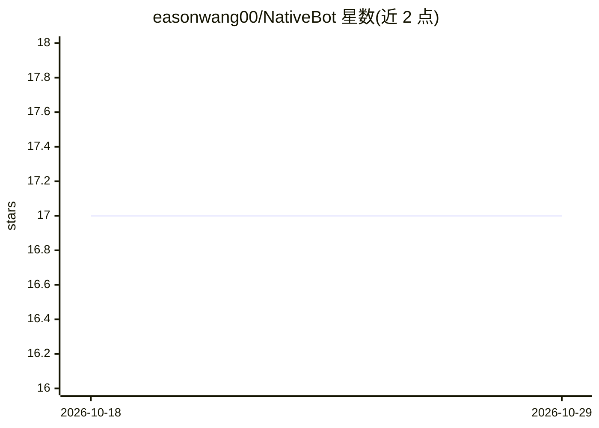

# easonwang00/NativeBot

⭐ 17 · Python · MIT · 推送 2026-03-25 · [GitHub](https://github.com/easonwang00/NativeBot) · [官网](https://nativebot.vercel.app) · 个人维护

**本地终端 AI 移动应用开发助手：对话生成 Expo 应用并上架**

基于终端的 CLI 工具，通过自然语言对话驱动 Claude 编写代码，生成基于 Expo React Native 的移动应用模板，支持构建失败时自动检测修复、Expo Go 手机热重载预览、EAS 构建并提交 App Store/Google Play。附带自托管 Telegram 机器人，可从手机发起对话与预览。全程本地运行，复用用户的 Claude 订阅，无需额外 API key；要求 Python 3.10+、Node.js 18+ 与 Claude 订阅。项目文件为本地真实目录，可在任意编辑器打开。

## 筛选速览

| 维度 | 判定 | 备注 |
|---|---|---|
| AI 角色 | `ai-ecosystem` | LLM/agent 周边工具 |
| 许可风险 | `permissive` | MIT |
| 部署形态 | `library` | 以包/库形式分发 |
| 模型依赖 | locked-api |  |
| 硬件要求 | — | 无带数字的原话,不猜 |
| 安装摩擦 | `low` | 无编译、无系统依赖或容器化 |
| 成熟度 | — | 结构信号不足 |

## 能力要点

- 对话驱动 Claude 生成 Expo React Native 移动应用
- 构建失败时自动检测并修复（self-heal）
- 自托管 Telegram 机器人，支持手机端对话与预览
- EAS 构建并提交 App Store / Google Play

## 适用场景

- 通过聊天让 AI 帮我开发并预览手机应用
- 在手机上通过 Telegram 远程继续开发项目
- 把对话生成的应用构建并上架应用商店

## 场景标签

`编码 Agent` · 领域:编码与开发

## 证据(README 行号)

> L7: Describe what you want → Claude writes the code → Preview on your phone → Ship to App Store.
> L108: You (terminal/Telegram)     NativeBot CLI          Claude Agent SDK
> L62: 2. **Chat** — Describe features in plain English, Claude writes the code

## 星数曲线

2026-10-18 17 → 2026-10-29 17（+0）

---
*卡片 v1 · prompt 1.4 · 生成 2026-10-29 · 置信度 mid · 依据 README sha `f71aaca2ee25` · [字段定义](../../DATASET.md)*
