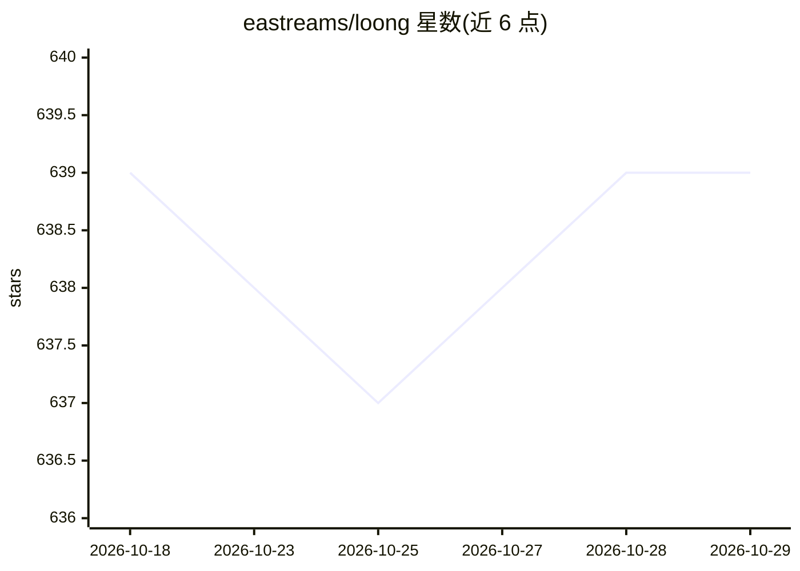

# eastreams/loong

⭐ 639 · Rust · MIT · 推送 2026-10-14 · [GitHub](https://github.com/eastreams/loong) · [官网](https://loongclaw.ai) · 组织维护 · 中文 README

**Rust 编写的垂直 AI agent 基础设施框架**

面向垂直领域 AI agent 的 Rust 基础框架：提供 42+ 内置 provider、25+ 渠道、统一 CLI（TUI 交互与 ask/chat/onboard/doctor 等命令）、技能/会话/网关/插件等运营 shell，以及飞书/Lark 渠道接入与 QR 注册流程。架构为 13-crate Rust 工作区、内核与扩展分离，provider、工具、渠道、记忆与策略均在内核之外按需编译组合；配置写入 ~/.loong/config.toml。支持脚本安装或从源码用 Cargo 构建（需 C linker 与 Rust 工具链）。

## 筛选速览

| 维度 | 判定 | 备注 |
|---|---|---|
| AI 角色 | `ai-ecosystem` | LLM/agent 周边工具 |
| 许可风险 | `permissive` | MIT |
| 部署形态 | `library` | 以包/库形式分发 |
| 模型依赖 | — | README 未给出锁定关系 |
| 硬件要求 | — | 无带数字的原话,不猜 |
| 安装摩擦 | `medium` | 含编译或系统依赖之一 |
| 成熟度 | — | 结构信号不足 |

## 能力要点

- 42+ 内置 provider 与 25+ 渠道，几条命令即可运行
- 13-crate Rust 工作区，内核与扩展（provider/工具/渠道/记忆/策略）分离
- 单一 loong 二进制提供 TUI、ask/chat/onboard/doctor/update 命令
- 内置 Lark/Feishu 渠道接入，含终端 QR 注册与凭据写入

## 适用场景

- 构建运行垂直领域的 AI agent 应用
- 通过飞书/Lark 等渠道把 agent 接入协作平台
- 在显式运行时边界内做长周期任务与复合任务执行

## 场景标签

`Agent 框架` · 领域:Agent 开发

## 证据(README 行号)

> L21: ***Secure, extensible, and sustainably evolvable*** — Loong is an agent base for vertical AI agents, built in Rust.
> L37: - **🚀 Rich configuration out of the box**: 42+ built-in providers, 25+ channels — up and running in a few commands.
> L43: - **⚡ Easy to start**: a few commands to get running, compatible with existing configurations from OpenClaw, Claude

## 星数曲线

2026-10-18 639 → 2026-10-29 639（+0）

---
*卡片 v1 · prompt 1.4 · 生成 2026-10-21 · 置信度 high · 依据 README sha `6533c9fc92f2` · [字段定义](../../DATASET.md)*
