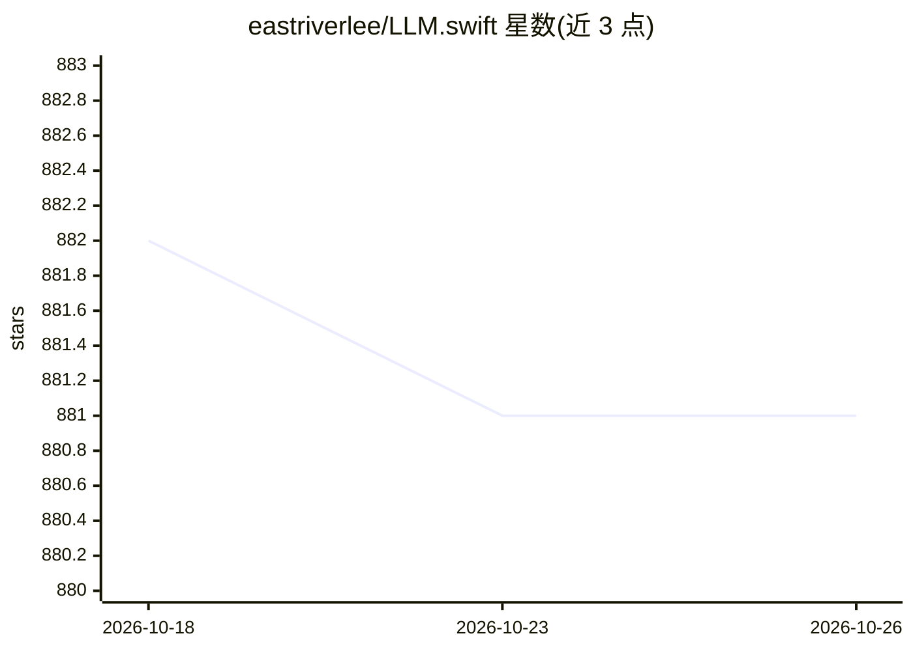

# eastriverlee/LLM.swift

⭐ 881 · Swift · MIT · 推送 2026-07-19 · [GitHub](https://github.com/eastriverlee/LLM.swift) · 个人维护

**苹果全平台本地 LLM 推理的 Swift 库**

基于 llama.cpp 的 Swift 库，供 macOS、iOS、watchOS、tvOS、visionOS 应用在本地与大语言模型交互。支持从 Bundle 加载 gguf 模型或直接从 HuggingFace 拉取模型；默认读取 gguf 内嵌 chat 模板（llama.cpp 的 Jinja 引擎执行）。提供 @Generatable 宏做类型安全结构化输出、原生 function calling、思维链分离（含 nothink 抑制）与文本嵌入及余弦相似度比较。经 SPM 集成，上下文增量维护以降低重复计算。

## 筛选速览

| 维度 | 判定 | 备注 |
|---|---|---|
| AI 角色 | `ai-ecosystem` | LLM/agent 周边工具 |
| 许可风险 | `permissive` | MIT |
| 部署形态 | `None` |  |
| 模型依赖 | local-ok | 支持本地模型 |
| 硬件要求 | — | 无带数字的原话,不猜 |
| 安装摩擦 | `low` | 无编译、无系统依赖或容器化 |
| 成熟度 | — | 结构信号不足 |

## 能力要点

- @Generatable 宏生成 JSON schema 实现结构化输出
- 基于模型原生模板的 function calling，多轮工具调用默认上限 4 轮
- thinking 内容分离，支持 enabled/suppressed(nothink)/none 三种模式
- 文本嵌入与余弦相似度、最相似候选查找

## 适用场景

- 在 iOS/macOS 应用中嵌入本地 LLM 对话能力
- 让模型调用我写的 Swift 函数获取数据回答问题
- 用结构化输出让模型直接产出可解析的 Swift 类型
- 在应用内做基于嵌入的语义相似度搜索

## 场景标签

`推理引擎` `语义搜索` · 领域:知识与检索

## 证据(README 行号)

> L3: `LLM.swift` is a simple and readable library that allows you to interact with large language models locally with eas
> L119: `LLM.swift` started as a lightweight abstraction layer over `llama.cpp`, and has evolved into a comprehensive Swif

## 星数曲线

2026-10-18 882 → 2026-10-26 881（-1）

---
*卡片 v1 · prompt 1.4 · 生成 2026-10-21 · 置信度 high · 依据 README sha `dd2aab651852` · [字段定义](../../DATASET.md)*
