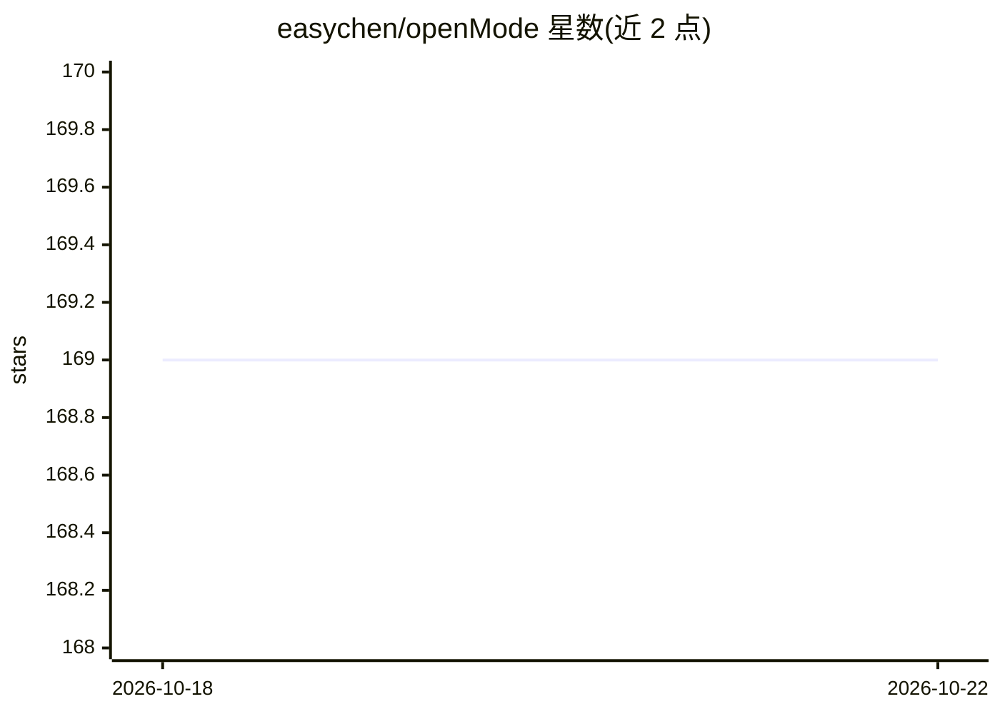

# easychen/openMode

⭐ 169 · Dart · MIT · 推送 2025-11-05 · [GitHub](https://github.com/easychen/openMode) · 个人维护

**OpenCode 的移动客户端：手机上连接并使用 AI 编程助手**

基于 Flutter 构建的 OpenCode 移动客户端（iOS/Android），通过配置服务器地址与端口连接自建的 OpenCode server 实例，提供 AI 对话界面、多会话管理、实时消息与连接测试功能。技术栈为 Dart/Provider/Dio，遵循 Clean Architecture。需自行准备 OpenCode 服务端并从源码用 Flutter SDK 编译运行，README 声明项目处于 WIP 状态、仅实现基础功能，绝大部分代码由 Cursor 生成。

## 筛选速览

| 维度 | 判定 | 备注 |
|---|---|---|
| AI 角色 | `ai-ecosystem` | LLM/agent 周边工具 |
| 许可风险 | `permissive` | MIT |
| 部署形态 | `None` |  |
| 模型依赖 | — | README 未给出锁定关系 |
| 硬件要求 | — | 无带数字的原话,不猜 |
| 安装摩擦 | `low` | 无编译、无系统依赖或容器化 |
| 成熟度 | `idea` | |

## 能力要点

- 连接 OpenCode 服务器的移动端聊天界面（可配置 Host/Port 并测试连接）
- 多会话创建与管理，实时消息通信
- Flutter 跨平台（iOS/Android），Material Design 3 暗色主题

## 适用场景

- 在手机上连接自己的 OpenCode 服务端进行 AI 对话
- 外出时管理多个编程助手会话

## 场景标签

 · 领域:开发工具/AI 编程

## 证据(README 行号)

> L7: **Mobile App for OpenCode and more**
> L16: - 🔗 **Server Connection**: Connect to OpenCode servers with configurable settings

## 星数曲线

2026-10-18 169 → 2026-10-22 169（+0）

---
*卡片 v1 · prompt 1.4 · 生成 2026-10-22 · 置信度 high · 依据 README sha `0f4ba5709642` · [字段定义](../../DATASET.md)*
