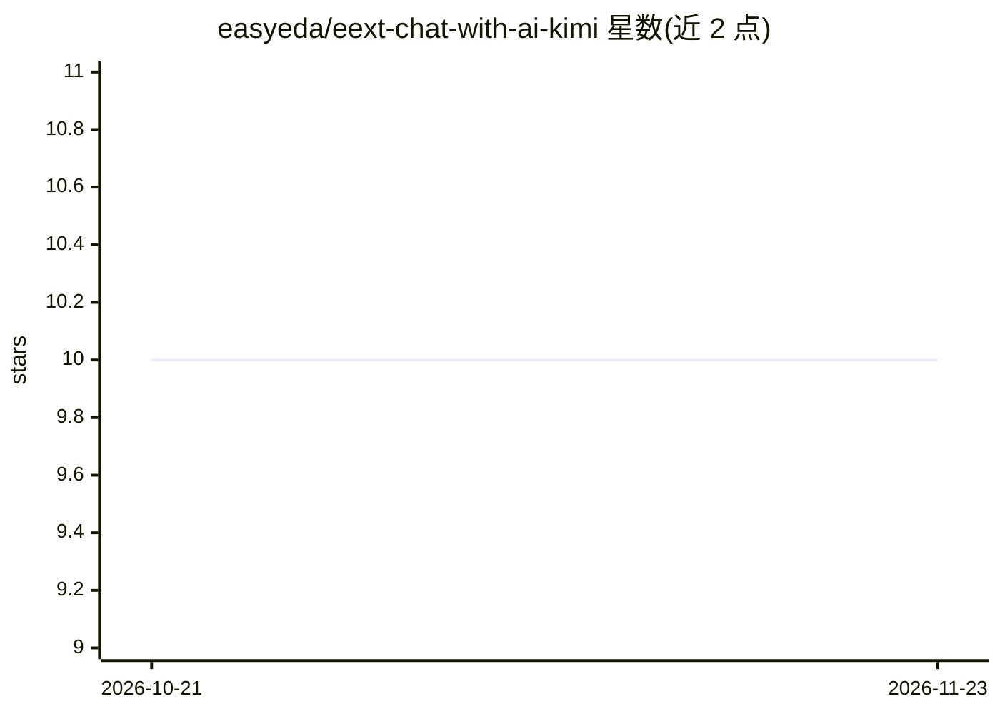

# easyeda/eext-chat-with-ai-kimi

⭐ 10 · HTML · Apache-2.0 · 推送 2026-10-12 · [GitHub](https://github.com/easyeda/eext-chat-with-ai-kimi) · 组织维护 · 中文 README

**嘉立创EDA专业版 PCB 设计人员的 Kimi AI 对话助手扩展**

嘉立创EDA专业版（EasyEDA Pro）的扩展插件，为 PCB 设计人员提供 AI 对话能力：通过对话查询设计内容，支持原理图元件点击查询、相似替换物料推荐、网表分析与电路图分析（需选择视觉模型并支持粘贴图片）。使用需在扩展管理器启用并开启外部交互，配置 Kimi API 密钥方可使用；网表分析功能声明 Tokens 消耗较大。功能经顶部菜单 Kimi 入口访问。

## 筛选速览

| 维度 | 判定 | 备注 |
|---|---|---|
| AI 角色 | `ai-native` | 本体是模型或模型工具 |
| 许可风险 | `permissive` | Apache-2.0 |
| 部署形态 | `None` |  |
| 模型依赖 | — | README 未给出锁定关系 |
| 硬件要求 | — | 无带数字的原话,不猜 |
| 安装摩擦 | `low` | 无编译、无系统依赖或容器化 |
| 成熟度 | — | 结构信号不足 |

## 能力要点

- AI 问答：原理图/PCB 绘制问题的专业回答
- 点击元件查询详情与相似替换物料推荐
- 原理图网表分析与电路图分析（支持视觉模型、粘贴图片）

## 适用场景

- 在嘉立创EDA中对话查询 PCB 设计相关问题
- 点击原理图元件获取替代物料
- 对原理图网表与电路图进行分析解读

## 场景标签

`聊天机器人` · 领域:对话与助手

## 证据(README 行号)

> L7: Kimi AI 助手是一款专为 PCB 设计人员开发的智能工具，具备以下核心功能：
> L10: 2. **元件管理**：支持元件选取与详细信息查询，包括相似物料推荐、网表解析及电路分析。
> L66: 选择视觉模型后，支持点击 **分析电路** 按钮或直接 Ctrl + V 粘贴图片到输入框，助手将会分析并回复电路图内容。

## 星数曲线

2026-10-21 10 → 2026-11-23 10（+0）

---
*卡片 v1 · prompt 1.4 · 生成 2026-11-19 · 置信度 high · 依据 README sha `a0b9d96c8389` · [字段定义](../../DATASET.md)*
