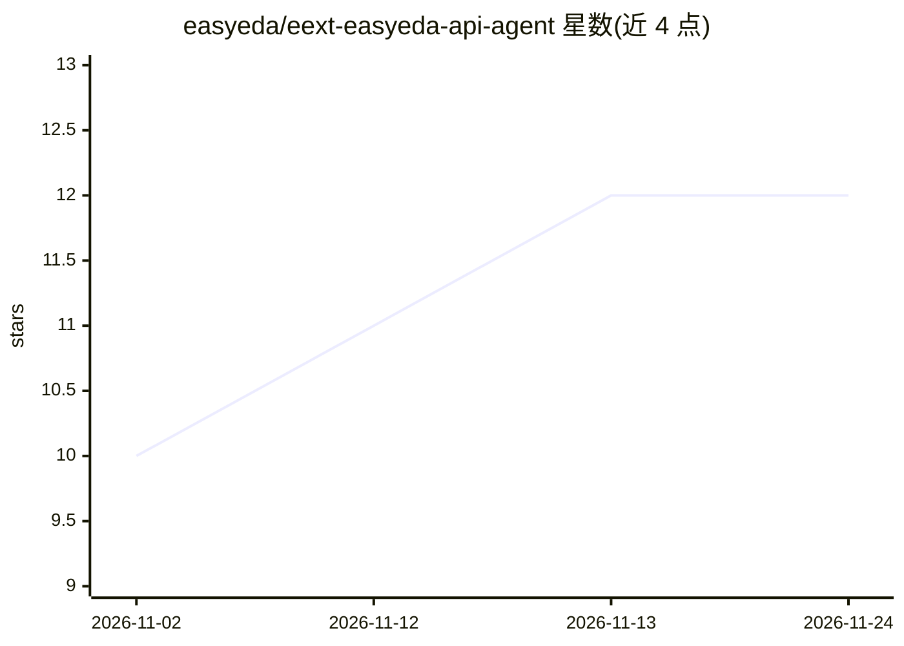

# easyeda/eext-easyeda-api-agent

⭐ 12 · JavaScript · Apache-2.0 · 推送 2026-07-30 · [GitHub](https://github.com/easyeda/eext-easyeda-api-agent) · 组织维护 · 中文 README

**嘉立创EDA专业版用户：自然语言/语音调用EDA扩展API的AI助手**

作为嘉立创EDA专业版的扩展插件运行，基于大模型将自然语言或语音指令转换为EDA扩展API调用，用户无需记忆API调用方法。支持接入DeepSeek进行智能对话，提供工具调用与结果解析；内置多语言实时语音识别与转文字；结果以Markdown渲染并支持代码高亮；可自定义API地址、密钥与温度参数，并提供API调用日志与请求响应查看等调试功能。

## 筛选速览

| 维度 | 判定 | 备注 |
|---|---|---|
| AI 角色 | `ai-native` | 本体是模型或模型工具 |
| 许可风险 | `permissive` | Apache-2.0 |
| 部署形态 | `None` |  |
| 模型依赖 | locked-api |  |
| 硬件要求 | — | 无带数字的原话,不猜 |
| 安装摩擦 | `low` | 无编译、无系统依赖或容器化 |
| 成熟度 | — | 结构信号不足 |

## 能力要点

- 自然语言理解并转换为EDA扩展API调用
- 多语言实时语音识别与语音转文字输入
- 自定义API地址、密钥与温度参数，设置本地自动保存
- API调用日志、请求响应查看与工具调用状态监控

## 适用场景

- 在嘉立创EDA专业版中用中文对话直接执行扩展API操作
- 通过语音输入免手动操作EDA功能
- 调试和查看扩展API调用的请求响应与错误信息

## 场景标签

`语音识别` `AI 助手` · 领域:对话与助手

## 证据(README 行号)

> L5: 基于大模型的扩展API助手，专为嘉立创EDA专业版设计。通过自然语言或语音交互，用户可以便捷地调用EDA扩展API功能，无需记忆复杂的 API 调用方法。
> L14: - 支持调用 DeepSeek，提供智能对话体验

## 星数曲线

2026-11-02 10 → 2026-11-24 12（+2）

---
*卡片 v1 · prompt 1.4 · 生成 2026-11-18 · 置信度 high · 依据 README sha `527deb7c662c` · [字段定义](../../DATASET.md)*
