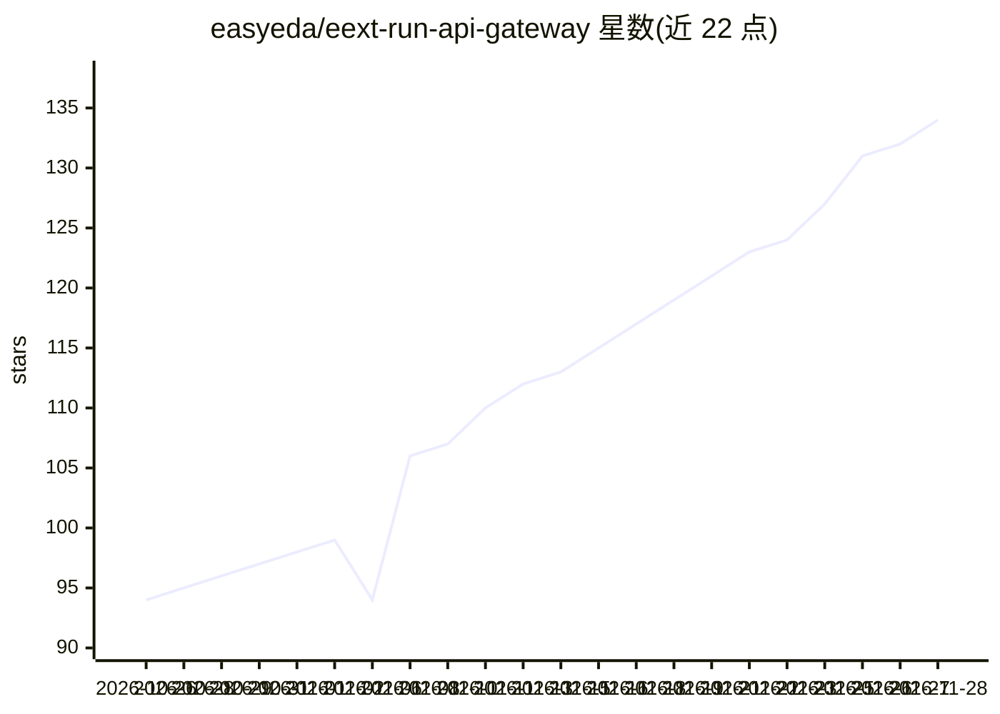

# easyeda/eext-run-api-gateway

⭐ 134 · TypeScript · Apache-2.0 · 推送 2026-11-19 · [GitHub](https://github.com/easyeda/eext-run-api-gateway) · 组织维护 · 中文 README

**为嘉立创EDA扩展提供 AI 编程工具的 WebSocket 网关桥接**

嘉立创EDA专业版的扩展，作为 AI 编程工具（OpenCode、Claude Code、Cursor、Cline 等）与 EDA 环境之间的 WebSocket API 网关。启动时自动扫描端口 49620-49629 发现 Bridge Server，通过握手验证身份，具备心跳检测、指数退避自动重连机制；接收 AI 发来的代码请求，在 EDA 环境中执行并返回结果。需配合 easyeda-api Skill 使用，后者负责启动 Bridge Server 与提供 API 文档。需 Node.js 22 LTS 及以上环境。

## 筛选速览

| 维度 | 判定 | 备注 |
|---|---|---|
| AI 角色 | `ai-ecosystem` | LLM/agent 周边工具 |
| 许可风险 | `permissive` | Apache-2.0 |
| 部署形态 | `library` | 以包/库形式分发 |
| 模型依赖 | — | README 未给出锁定关系 |
| 硬件要求 | — | 无带数字的原话,不猜 |
| 安装摩擦 | `low` | 无编译、无系统依赖或容器化 |
| 成熟度 | — | 结构信号不足 |

## 能力要点

- 自动扫描端口 49620-49629 连接 Bridge Server
- 心跳检测与 3s→30s 指数退避自动重连
- 接收 AI 代码请求并在 EDA 环境中执行返回结果
- 提供 Reconnect/Stop Connection 等菜单操作

## 适用场景

- 让 AI 编程工具读取并检查我的原理图
- 通过对话让 AI 在嘉立创EDA中绘制电路（如 NE555 最小系统）
- EDA 与 AI 工具间连接中断后自动恢复会话

## 场景标签

 · 领域:EDA/开发工具集成

## 证据(README 行号)

> L5: 嘉立创EDA 专业版扩展 — 为 AI 编程工具（OpenCode、Claude Code、Cursor、Cline、Continue、Windsurf、WorkBuddy、QwenCode、KimiCode、Trae 等）提供 W
> L12: - 🤖 **代码执行** — 接收来自 AI 的代码请求，在 EDA 环境中执行并返回结果

## 星数曲线

2026-10-26 94 → 2026-11-28 134（+40）

---
*卡片 v1 · prompt 1.4 · 生成 2026-11-28 · 置信度 mid · 依据 README sha `8bf8ec53ebe5` · [字段定义](../../DATASET.md)*
