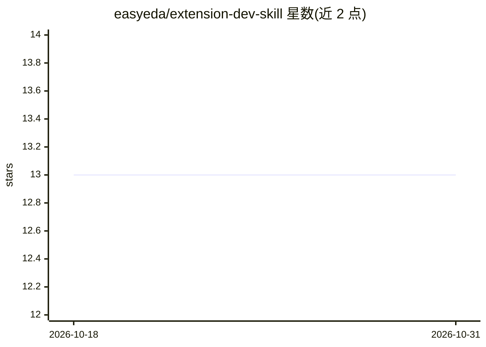

# easyeda/extension-dev-skill

⭐ 13 · JavaScript · 推送 2026-08-06 · [GitHub](https://github.com/easyeda/extension-dev-skill) · 组织维护 · 中文 README

**面向 AI Agent 的嘉立创EDA 扩展开发技能包**

嘉立创EDA（EasyEDA 专业版）扩展插件开发的 AI Skill 包，供 QwenCode、OpenCode 等 coding agent 加载使用。核心机制：基于目标项目 node_modules 中的 pro-api-types 类型定义做类型驱动的 API 查询，并提供确定性 CLI（doctor/search/inspect）；另含 recipes 与 guide 场景流程文档。安装方式为 git clone 到各 agent 的 skills 目录，已在 OpenClaw/OpenCode/QwenCode/Kiro/Trae 五个平台测试。

## 筛选速览

| 维度 | 判定 | 备注 |
|---|---|---|
| AI 角色 | `ai-ecosystem` | LLM/agent 周边工具 |
| 许可风险 | `none` | — |
| 部署形态 | `None` |  |
| 模型依赖 | — | README 未给出锁定关系 |
| 硬件要求 | — | 无带数字的原话,不猜 |
| 安装摩擦 | `low` | 无编译、无系统依赖或容器化 |
| 成熟度 | — | 结构信号不足 |

## 能力要点

- 基于目标项目 SDK 类型定义（pro-api-types）的 API 查询
- 确定性 CLI scripts/eda-api.js，支持 doctor/search/inspect
- recipes/guide 提供场景流程与运行时语义知识
- 在 5 个 agent 平台（QwenCode/OpenCode/OpenClaw/Kiro/Trae）测试

## 适用场景

- 让 coding agent 辅助开发嘉立创EDA 扩展插件时查询 API
- 按当前项目安装的 SDK 版本核验 API 可用性
- 通过 CLI 检查开发环境与检索类型信息

## 场景标签

 · 领域:EDA 工具/插件开发

## 证据(README 行号)

> L5: 用于 嘉立创EDA & EasyEDA 专业版 扩展插件开发的 AI Skill。它提供类型驱动的 API 查询工具和插件开发工作流，让 API 查询以目标项目当前安装的 SDK 为准。
> L10: - 基于目标项目 `node_modules/@jlceda/pro-api-types/index.d.ts` 的类型驱动 API 查询

## 星数曲线

2026-10-18 13 → 2026-10-31 13（+0）

---
*卡片 v1 · prompt 1.4 · 生成 2026-10-31 · 置信度 high · 依据 README sha `b6685683b65d` · [字段定义](../../DATASET.md)*
