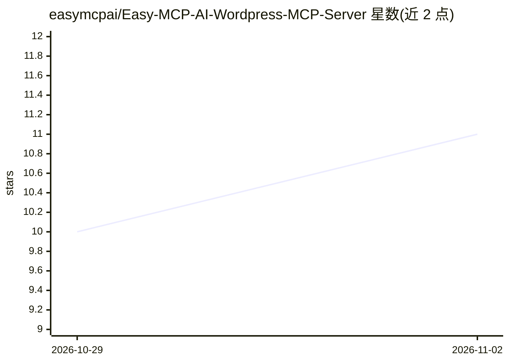

# easymcpai/Easy-MCP-AI-Wordpress-MCP-Server

⭐ 11 · GPL-2.0 · 推送 2026-06-01 · [GitHub](https://github.com/easymcpai/Easy-MCP-AI-Wordpress-MCP-Server) · [官网](https://easymcpai.com/) · 组织维护

**把 WordPress 站点暴露为远程 MCP 服务器的插件（214 工具）**

WordPress 插件，将站点以远程 MCP 服务器形式通过 HTTPS 暴露，供 Claude、ChatGPT、Cursor、Gemini、n8n 等 MCP 兼容客户端通过对话管理站点内容、媒体、用户、SEO、分析与 WooCommerce。提供 OAuth 2.1 与手动 Bearer token 两种接入方式，token 继承所选 WordPress 用户的权限，可按工具限定范围；无需 Node.js 或代理进程。安装经 WordPress.org 插件目录或 ZIP 上传，要求 WordPress 6.0+、PHP 7.4+。本仓库仅为配置与集成文档，源码在 WordPress.org SVN。

## 筛选速览

| 维度 | 判定 | 备注 |
|---|---|---|
| AI 角色 | `ai-ecosystem` | LLM/agent 周边工具 |
| 许可风险 | `viral` | GPL-2.0 |
| 部署形态 | `desktop` | 安装包/桌面程序 |
| 模型依赖 | locked-api |  |
| 硬件要求 | — | 无带数字的原话,不猜 |
| 安装摩擦 | `low` | 无编译、无系统依赖或容器化 |
| 成熟度 | — | 结构信号不足 |

## 能力要点

- 214 个工具、14 个资源，覆盖文章、媒体、用户、WooCommerce（46 工具）等
- OAuth 2.1 一键连接与手动 Bearer token 两种认证方式
- token 继承 WordPress 用户权限并可按工具白名单限制
- 提供 MCP 写入操作的历史记录与 diff 工具

## 适用场景

- 在 Claude/Cursor 等 AI 客户端中通过对话管理 WordPress 站点
- 让 AI 批量管理 WooCommerce 商品与变体
- 对 AI 通过 MCP 执行的站点修改做历史审计

## 场景标签

 · 领域:Web/WordPress 基础设施

## 证据(README 行号)

> L19: Easy MCP AI exposes your WordPress site as a **remote MCP server** over HTTPS. Any MCP-compatible AI client — assis
> L21: Install the plugin, generate a token, paste your endpoint URL into your AI client. Nothing else runs on your server

## 星数曲线

2026-10-29 10 → 2026-11-02 11（+1）

---
*卡片 v1 · prompt 1.4 · 生成 2026-11-02 · 置信度 high · 依据 README sha `831e49132419` · [字段定义](../../DATASET.md)*
