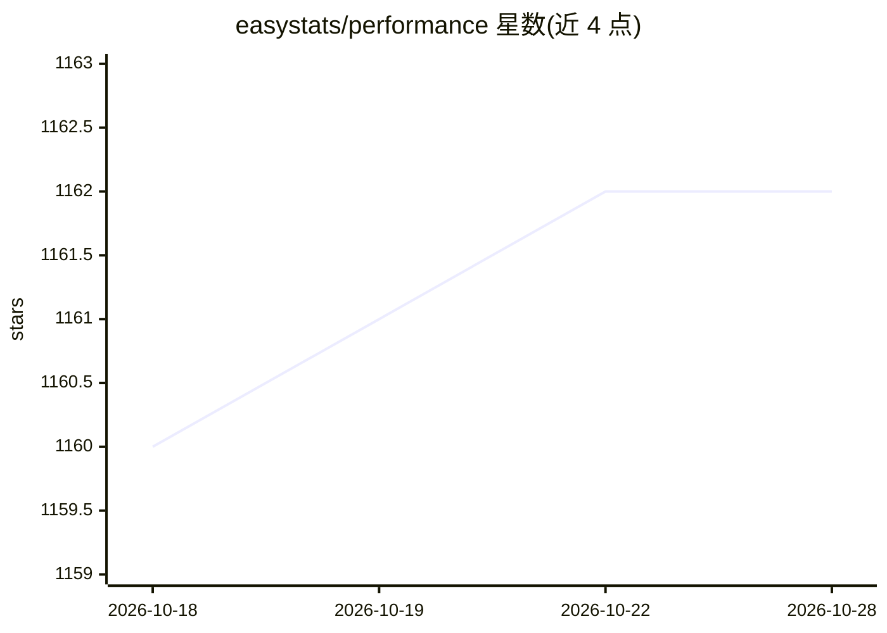

# easystats/performance

⭐ 1,162 · R · GPL-3.0 · 推送 2026-10-28 · [GitHub](https://github.com/easystats/performance) · [官网](https://easystats.github.io/performance/) · 组织维护

**R 回归模型质量与性能指标计算包（R2/ICC/AIC/诊断）**

easystats 生态中的 R 包，提供回归模型质量与拟合优度指标的计算：通用 r2() 与 icc() 覆盖混合效应与贝叶斯模型，model_performance() 输出 AIC/BIC/RMSE/LOOIC 等指标，compare_performance() 支持跨模型比较与综合排名。另含模型诊断函数：检验过度离散、零膨胀、奇异性拟合、异方差与共线性，check_model() 汇总可视化（绘图依赖 see 包）。面向 R 统计建模用户，CRAN 与 R-universe 提供安装。

## 筛选速览

| 维度 | 判定 | 备注 |
|---|---|---|
| AI 角色 | `ai-ecosystem` | LLM/agent 周边工具 |
| 许可风险 | `viral` | GPL-3.0 |
| 部署形态 | `None` |  |
| 模型依赖 | — | README 未给出锁定关系 |
| 硬件要求 | — | 无带数字的原话,不猜 |
| 安装摩擦 | `low` | 无编译、无系统依赖或容器化 |
| 成熟度 | — | 结构信号不足 |

## 能力要点

- 通用 r2()/icc() 覆盖含混合效应与贝叶斯在内的多种模型
- model_performance() 按模型类型输出 AIC/BIC/RMSE/ICC/LOOIC 等指标
- check_model() 等诊断函数检验过度离散、零膨胀、奇异性、异方差、共线性
- compare_performance() 支持异构模型比较、综合排名与可视化

## 适用场景

- 拟合回归后统一计算应报告的拟合指标
- 对混合模型做过离散、零膨胀、奇异性等诊断
- 比较多个候选模型并按综合指标排序

## 场景标签

`模型评测` · 领域:评测与运维

## 证据(README 行号)

> L16: The primary goal of the **performance** package is to fill this gap and
> L240: `model_performance()` computes indices of model performance for

## 星数曲线

2026-10-18 1,160 → 2026-10-28 1,162（+2）

---
*卡片 v1 · prompt 1.4 · 生成 2026-10-21 · 置信度 high · 依据 README sha `edf7949d4bfe` · [字段定义](../../DATASET.md)*
