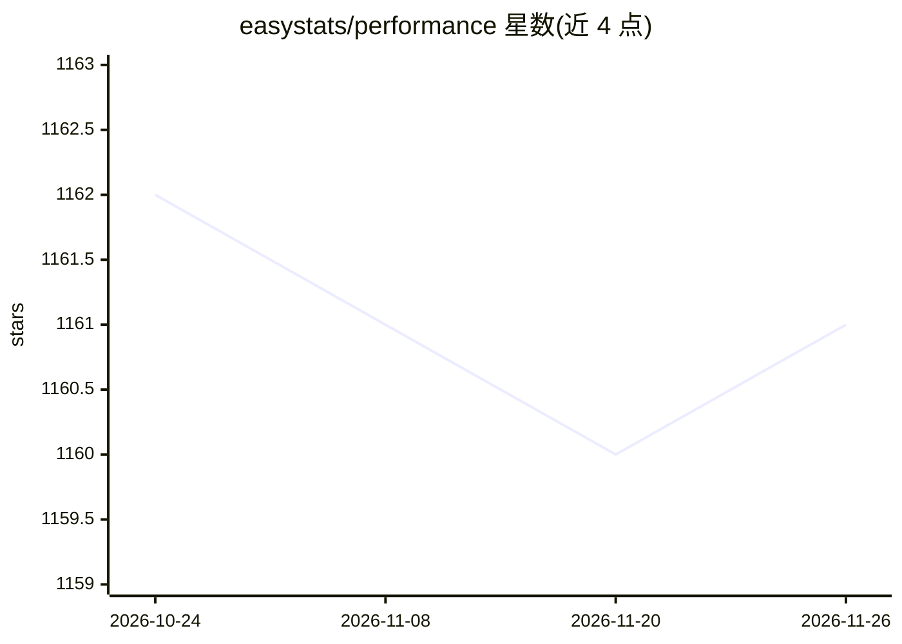

# easystats/performance

⭐ 1,161 · R · GPL-3.0 · 推送 2026-11-25 · [GitHub](https://github.com/easystats/performance) · [官网](https://easystats.github.io/performance/) · 组织维护

**R 包：统一计算回归模型质量与拟合指标**

easystats 生态中的 R 包，把分散在各包中的模型质量评估功能收拢到统一接口：提供 r2() 计算 R²（含混合模型与贝叶斯模型的边际/条件 R²）、icc() 计算组内相关系数、model_performance() 汇总 AIC/BIC/RMSE/LOOIC 等指标，以及检查过离散、零膨胀、奇异拟合、异方差等假设的诊断函数，并支持多模型比较排名。发布于 CRAN，开发版在 R-universe。

## 筛选速览

| 维度 | 判定 | 备注 |
|---|---|---|
| AI 角色 | `ai-ecosystem` | LLM/agent 周边工具 |
| 许可风险 | `viral` | GPL-3.0 |
| 部署形态 | `None` |  |
| 模型依赖 | — | README 未给出锁定关系 |
| 硬件要求 | — | 无带数字的原话,不猜 |
| 安装摩擦 | `low` | 无编译、无系统依赖或容器化 |
| 成熟度 | — | 结构信号不足 |

## 能力要点

- r2() 对多种模型类型返回适配的 R²，含混合模型的边际/条件 R²
- check_overdispersion()/check_zeroinflation()/check_singularity()/check_heteroscedasticity() 等模型诊断
- model_performance() 汇总 R²/AIC/BIC/RMSE/ICC/LOOIC 指标
- compare_performance() 与 test_performance() 支持多模型比较与检验

## 适用场景

- 回归建模后评估拟合优度并选择报告哪些拟合指标
- 诊断混合模型是否过离散、零膨胀或奇异拟合
- 对多个候选模型比较性能并排序

## 场景标签

`模型评测` · 领域:评测与运维

## 证据(README 行号)

> L16: The primary goal of the **performance** package is to fill this gap and
> L224: **performance** provides many functions to check model assumptions, like

## 星数曲线

2026-10-24 1,162 → 2026-11-26 1,161（-1）

---
*卡片 v1 · prompt 1.4 · 生成 2026-11-24 · 置信度 high · 依据 README sha `5c16f5193b5f` · [字段定义](../../DATASET.md)*
