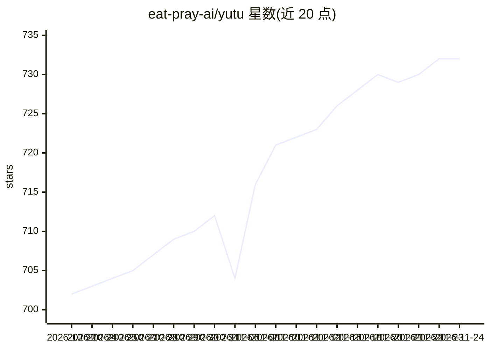

# eat-pray-ai/yutu

⭐ 732 · Go · Apache-2.0 · 推送 2026-11-21 · [GitHub](https://github.com/eat-pray-ai/yutu) · [官网](https://yutu.ifor.dev) · 个人维护 · 中文 README

**为开发者自动化 YouTube 工作流的 CLI、MCP 服务器与 AI Agent**

用 Go 编写的三形态工具：CLI 直接执行 YouTube 上传、评论、播放列表、频道品牌等操作；MCP 服务器可挂接到 Claude、opencode、codex 等 AI 客户端；内置 Agent 模式（Miffy）支持 google/openai/anthropic 三类 provider 并可自定义 base-url。安装需先在 GCP 创建项目、启用 YouTube Data API v3 并配置 OAuth 桌面应用凭据。另以 npx skills 形式发布 youtube-automation 技能包。

## 筛选速览

| 维度 | 判定 | 备注 |
|---|---|---|
| AI 角色 | `ai-ecosystem` | LLM/agent 周边工具 |
| 许可风险 | `permissive` | Apache-2.0 |
| 部署形态 | `desktop` | 安装包/桌面程序 |
| 模型依赖 | — | README 未给出锁定关系 |
| 硬件要求 | — | 无带数字的原话,不猜 |
| 安装摩擦 | `low` | 无编译、无系统依赖或容器化 |
| 成熟度 | — | 结构信号不足 |

## 能力要点

- CLI / MCP 服务器 / AI Agent 三种形态复用同一套 YouTube 工作流
- Agent 支持 google、openai、anthropic 三类 provider 与自定义 endpoint
- 提供 npx skills 安装的 YouTube 领域技能（含 SEO 实践）
- 发布物提供加密签名的 attestation 校验

## 适用场景

- 从终端批量上传和管理视频与评论
- 把 YouTube 操作以 MCP 工具形式接入 AI 客户端
- 为 AI Agent 补充 YouTube 领域知识与工作流技能

## 场景标签

`工作流自动化` · 领域:效率与自动化

## 证据(README 行号)

> L22: `yutu` is a CLI, MCP server, and AI Agent to automate YouTube workflows — from uploading and optimizing videos to m
> L167: Before using `yutu` as an MCP server, make sure `yutu` is installed(see Installation section), and you have a vali

## 星数曲线

2026-10-22 702 → 2026-11-24 732（+30）

---
*卡片 v1 · prompt 1.4 · 生成 2026-11-24 · 置信度 high · 依据 README sha `cbda42a67e82` · [字段定义](../../DATASET.md)*
