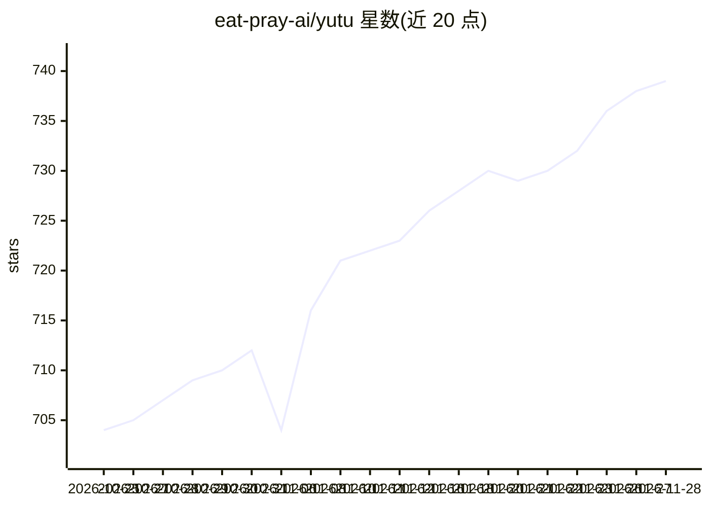

# eat-pray-ai/yutu

⭐ 739 · Go · Apache-2.0 · 推送 2026-11-27 · [GitHub](https://github.com/eat-pray-ai/yutu) · [官网](https://yutu.ifor.dev) · 个人维护 · 中文 README

**用 CLI/MCP/Agent 自动化 YouTube 运营流程的工具**

以 Go 编写的 YouTube 工作流自动化工具，同一二进制提供三种形态：终端 CLI、MCP server、AI Agent（Miffy）。可自动化视频上传与优化、评论/播放列表/频道品牌管理，并附带可安装到 AI Agent 的 YouTube 领域 skill，含增长策略与 SEO 实践。使用需先配置 GCP 项目、启用 YouTube Data API 并完成 OAuth 授权；Agent 模式默认不构建，需 -tags agent 编译或安装。提供 npm/Homebrew/WinGet/Docker/安装脚本等多种分发渠道。

## 筛选速览

| 维度 | 判定 | 备注 |
|---|---|---|
| AI 角色 | `ai-enhanced` | 去掉 AI 部分产品仍成立 |
| 许可风险 | `permissive` | Apache-2.0 |
| 部署形态 | `desktop` | 安装包/桌面程序 |
| 模型依赖 | — | README 未给出锁定关系 |
| 硬件要求 | — | 无带数字的原话,不猜 |
| 安装摩擦 | `low` | 无编译、无系统依赖或容器化 |
| 成熟度 | — | 结构信号不足 |

## 能力要点

- CLI、MCP server、AI Agent 三形态共用同一工具
- MCP 一条命令接入 claude/opencode/codex 等多个 Agent
- 提供 youtube-automation skill，覆盖视频/播放列表/评论/频道等操作
- 分发渠道覆盖 npm、Homebrew、WinGet、Docker、安装脚本，并带签名证明验证

## 适用场景

- 在终端批量管理视频上传、评论和播放列表
- 把 YouTube 操作作为 MCP 工具接入自己的 AI Agent
- 让 Agent 依据内置 SEO 与增长策略优化频道内容

## 场景标签

`工作流自动化` · 领域:效率与自动化

## 证据(README 行号)

> L22: `yutu` is a CLI, MCP server, and AI Agent to automate YouTube workflows — from uploading and optimizing videos to m
> L151: > Agent mode is gated behind the `agent` build tag. Prebuilt and default builds only include CLI + MCP; to include

## 星数曲线

2026-10-25 704 → 2026-11-28 739（+35）

---
*卡片 v1 · prompt 1.4 · 生成 2026-11-28 · 置信度 high · 依据 README sha `2f520b5af9f6` · [字段定义](../../DATASET.md)*
