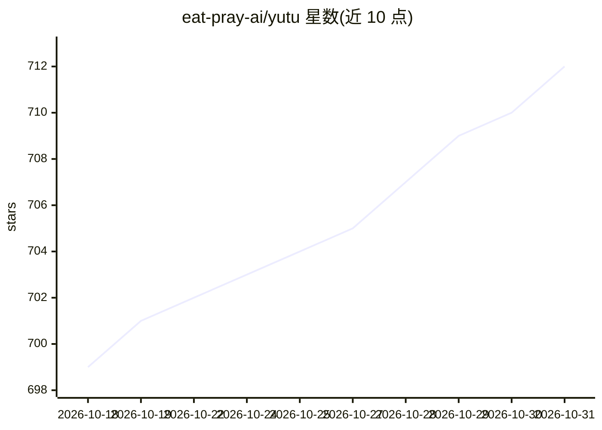

# eat-pray-ai/yutu

⭐ 712 · Go · Apache-2.0 · 推送 2026-10-28 · [GitHub](https://github.com/eat-pray-ai/yutu) · [官网](https://yutu.ifor.dev) · 个人维护 · 中文 README

**自动化 YouTube 运营的 CLI/MCP 服务器/AI 代理工具**

用 Go 编写的多形态 YouTube 工作流工具：作为 CLI 直接调用 YouTube Data API 完成视频上传、评论、播放列表、频道品牌等操作；作为 MCP 服务器接入 Claude Code、Codex、VS Code、Cursor 等客户端；内置 agent 模式（Miffy），支持 Gemini 或 OpenAI 兼容提供商并自带 YouTube 增长策略与 SEO 指令；另提供可安装到 AI agent 的 youtube 技能包。使用需配置 Google Cloud OAuth 凭据，提供 npm、Docker、Homebrew、winget、go install、脚本等多种安装方式。

## 筛选速览

| 维度 | 判定 | 备注 |
|---|---|---|
| AI 角色 | `ai-ecosystem` | LLM/agent 周边工具 |
| 许可风险 | `permissive` | Apache-2.0 |
| 部署形态 | `desktop` | 安装包/桌面程序 |
| 模型依赖 | — | README 未给出锁定关系 |
| 硬件要求 | — | 无带数字的原话,不猜 |
| 安装摩擦 | `low` | 无编译、无系统依赖或容器化 |
| 成熟度 | — | 结构信号不足 |

## 能力要点

- CLI / MCP 服务器 / agent 三种使用形态
- agent 模式支持 Gemini 与 OpenAI 兼容提供商，可自定义 base-url
- 可配置为 Claude Code、Codex、VS Code、Cursor 等的 MCP 服务器
- 提供覆盖视频/播放列表/评论/字幕等操作的 youtube agent 技能包

## 适用场景

- 从终端批量上传和管理 YouTube 视频与播放列表
- 在 Claude Code 或 Cursor 中通过 MCP 操作 YouTube 频道
- 让 AI agent 依据内置 SEO 策略自动执行频道运营任务

## 场景标签

`工作流自动化` · 领域:效率与自动化

## 证据(README 行号)

> L23: `yutu` is a CLI, MCP server, and AI agent to automate YouTube workflows — from uploading and optimizing videos to m
> L170: You can configure `yutu` as an MCP server for your preferred tool using the instructions below.
> L203: `yutu` provides a unified skill that extends AI agents with YouTube domain knowledge, common workflows, and SEO be

## 星数曲线

2026-10-18 699 → 2026-10-31 712（+13）

---
*卡片 v1 · prompt 1.4 · 生成 2026-10-21 · 置信度 high · 依据 README sha `16301f82a8fd` · [字段定义](../../DATASET.md)*
