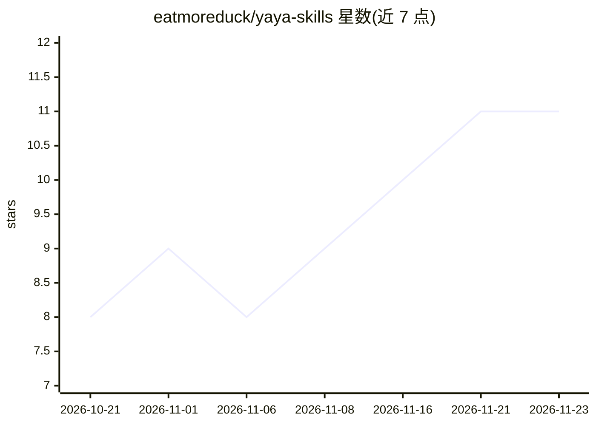

# eatmoreduck/yaya-skills

⭐ 11 · Python · MIT · 推送 2026-11-19 · [GitHub](https://github.com/eatmoreduck/yaya-skills) · 个人维护 · 中文 README

**写作者的 X Space 转中文干货笔记 Agent 技能集**

一套遵循 Agent Skills 规范的技能集合：下载 X Space 音频、本地转写并做说话人分离，再由 LLM 蒸馏成按说话人分组的中文笔记与分享图。分层组织为原子 skill（下载/转写/分离/语料合成）与场景编排 skill（yaya-xspace），音频全程不出本机，模型首次运行自动下载。支持通过插件市场或任意兼容 Agent 的技能规范安装，MIT 许可。

## 筛选速览

| 维度 | 判定 | 备注 |
|---|---|---|
| AI 角色 | `ai-native` | 本体是模型或模型工具 |
| 许可风险 | `permissive` | MIT |
| 部署形态 | `None` |  |
| 模型依赖 | — | README 未给出锁定关系 |
| 硬件要求 | — | 无带数字的原话,不猜 |
| 安装摩擦 | `low` | 无编译、无系统依赖或容器化 |
| 成熟度 | — | 结构信号不足 |

## 能力要点

- X Space 链接 → 带说话人标签的中文干货笔记与分享图
- 本地运行：转写在 MLX/GPU、分离在 CPU 并行执行，音频不出本机
- 原子 skill（yaya-xdl / yaya-asr / yaya-diarize / yaya-corpus）可单独使用
- 分享图内置四种卡面风格，--style 切换

## 适用场景

- 把两小时 X Space 归档成可检索的中文笔记
- 给播客/语音内容生成带说话人的文字稿
- 把文字稿反向合成可听音频与双语字幕

## 场景标签

`语音识别` `语音合成` · 领域:内容生成

## 证据(README 行号)

> L13: > **首期主打：X Space 录音转文字。** 开车、做饭时听到一段好内容，想记，手上忙着记不了；等忙完只剩个模糊印象，回放 30 天后还被平台直接删掉。一条链接，把一场两小时的 Space 变成按说话人分组、金句原话全保留的
> L54: - **`yaya-asr` 内部是流水线**：转写（MLX/GPU）一开始就后台拉起分离（yaya-diarize，CPU），两者**并行执行**，互不争抢。
> L117: skill 是通用的 Markdown+脚本格式（Agent Skills 规范），**不绑定任何一家 Agent**——Claude Code、Codex、Cursor、Windsurf、ZCode 等所有支持该规范的 Age

## 星数曲线

2026-10-21 8 → 2026-11-23 11（+3）

---
*卡片 v1 · prompt 1.4 · 生成 2026-11-19 · 置信度 high · 依据 README sha `7946344c7cbc` · [字段定义](../../DATASET.md)*
