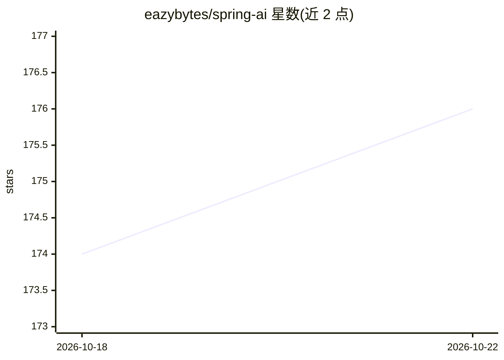

# eazybytes/spring-ai

⭐ 176 · Java · 推送 2026-06-29 · [GitHub](https://github.com/eazybytes/spring-ai) · [官网](https://www.udemy.com/course/java-spring-ai/?referralCode=144430555105E7ADD679) · 组织维护

**Spring AI 课程的参考资源与工具链接汇总**

面向 Java 开发者的 Spring AI 课程配套 GitHub 仓库，内容为课程中使用到的参考链接与工具清单：Spring AI 官方文档、OpenAI 平台文档、Ollama 本地模型运行、AWS Bedrock、Docker Desktop 与 Docker Model Runner、Transformer 论文与 OpenAI Tokenizer、Qdrant 向量数据库与 MCP 协议，以及 Prometheus/Micrometer/OpenTelemetry/Grafana/Jaeger 等可观测性工具。仓库本身不包含课程代码，仅提供链接索引；遇到问题通过 GitHub issue 或联系课程讲师。

## 筛选速览

| 维度 | 判定 | 备注 |
|---|---|---|
| AI 角色 | `ai-knowledge` | 知识聚合/清单类 |
| 许可风险 | `none` | — |
| 部署形态 | `self-host` | docker 或自建部署 |
| 模型依赖 | — | README 未给出锁定关系 |
| 硬件要求 | — | 无带数字的原话,不猜 |
| 安装摩擦 | `low` | 无编译、无系统依赖或容器化 |
| 成熟度 | — | 结构信号不足 |

## 能力要点

- 覆盖 Spring AI 文档与 OpenAI 平台文档的官方参考链接
- 列举 Ollama、AWS Bedrock、Docker Model Runner 等 AI 运行时工具
- 收录 Qdrant 向量库与 MCP 协议等 RAG 相关资源
- 汇总 Prometheus/Grafana/OpenTelemetry 等可观测性工具链接

## 适用场景

- 学习 Spring AI 课程时快速查找配套工具与文档
- 搭建 Spring Boot + LLM 应用时参考选用的运行时与监控工具
- 了解 Spring AI 生态涉及的向量库与 MCP 协议资源

## 场景标签

`精选清单` · 领域:学习与行业

## 证据(README 行号)

> L3: ## 🌱 Spring AI Course – Resources & Reference Links
> L5: Welcome to the official GitHub repository for the **Spring AI Course**. This course helps you build intelligent appl

## 星数曲线

2026-10-18 174 → 2026-10-22 176（+2）

---
*卡片 v1 · prompt 1.4 · 生成 2026-10-22 · 置信度 mid · 依据 README sha `514f3acb72b2` · [字段定义](../../DATASET.md)*
