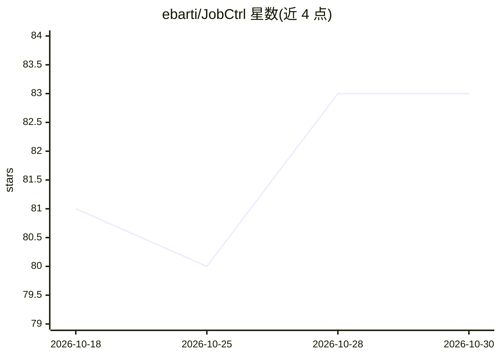

# ebarti/JobCtrl

⭐ 83 · Python · AGPL-3.0 · 推送 2026-10-29 · [GitHub](https://github.com/ebarti/JobCtrl) · [官网](https://jobctrl.dev) · 个人维护

**本地优先的求职自动化应用：发现岗位、评分、定制简历**

运行在用户本机的求职搜索与申请管理应用：搜索职位板与公司来源，按用户档案证据对岗位逐条评分（1–10），生成简历与求职信并要求每条经历可溯源到档案事实，草稿中虚构的指标/日期/头寸会校验失败。申请环节默认人工审批，自动投递仅限用户批准的邮件且每岗位至多一次。数据存于 ~/.jobctrl/，无账号无托管后端。基于 Temporal 工作流引擎，崩溃或重启后可恢复。需连接用户自有 LLM 账户（Codex/Claude/Google）。签名版本面向 Apple silicon Mac（macOS 15+），处于早期访问阶段。

## 筛选速览

| 维度 | 判定 | 备注 |
|---|---|---|
| AI 角色 | `ai-native` | 本体是模型或模型工具 |
| 许可风险 | `viral` | AGPL-3.0 |
| 部署形态 | `None` |  |
| 模型依赖 | locked-api |  |
| 硬件要求 | — | 无带数字的原话,不猜 |
| 安装摩擦 | `low` | 无编译、无系统依赖或容器化 |
| 成熟度 | `idea` | |

## 能力要点

- 岗位需求逐条对照档案证据的 1–10 评分
- 简历条目链接到档案事实，虚构指标/日期/头寸校验失败
- Temporal 工作流驱动，崩溃或重启后步骤可恢复
- 默认关闭自动投递，邮件申请需逐次审批且每岗位至多一次；默认每日 LLM 预算 $25

## 适用场景

- 自动发现并持续追踪匹配目标职位的招聘信息
- 为每个岗位生成有事实依据的定制简历和求职信
- 本地管理求职流程与申请结果，数据不出本机

## 场景标签

`工作流自动化` `AI 写作` `网页抓取` · 领域:效率与自动化

## 证据(README 行号)

> L17: JobCtrl finds job postings, scores each one against your profile, writes a
> L33: app. Create your profile, then connect an LLM provider (Codex, Claude, or

## 星数曲线

2026-10-18 81 → 2026-10-30 83（+2）

---
*卡片 v1 · prompt 1.4 · 生成 2026-10-24 · 置信度 high · 依据 README sha `f41c7579eb81` · [字段定义](../../DATASET.md)*
